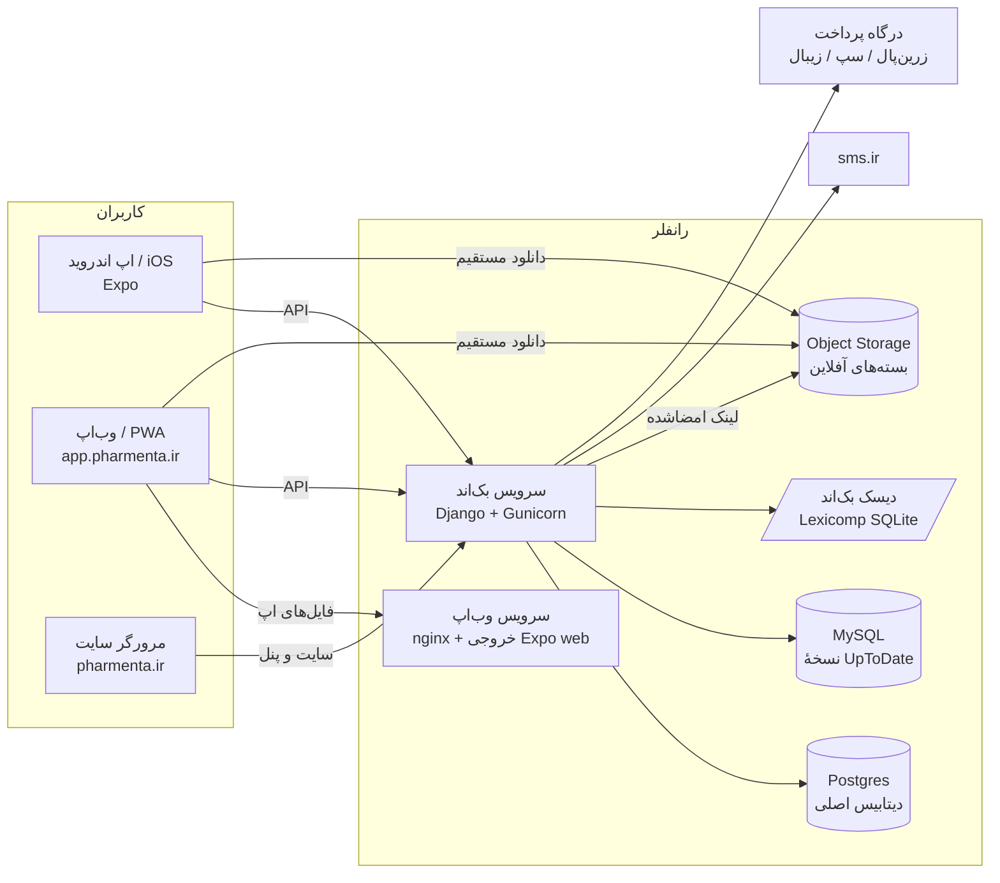

# ۱. معرفی و معماری

## محصول

فارمنتا اپ آموزشی دانشجویان و فارغ‌التحصیلان داروسازی و پزشکی است. زبان اصلی فارسی است (راست‌به‌چپ) و همهٔ متن‌های آموزشی دوزبانه (فارسی و انگلیسی) نگهداری می‌شوند. اپ با یک کد روی اندروید، iOS و وب اجرا می‌شود.

> فارمنتا نرم‌افزار آموزشی است، نه ابزار تصمیم‌گیری بالینی. خلاصه‌های دارویی و محتوای ساخته‌شده با مدل‌های زبانی پیش از انتشار باید به تأیید افراد متخصص برسند.

## قابلیت‌ها

| قابلیت | کار | اپ بک‌اند | صفحه‌های اپ | کلید فروش (feature) |
|---|---|---|---|---|
| درس‌نامهٔ دارویی | داروها بر اساس موضوع درسی و گروه ATC، با خلاصهٔ بالینی دوزبانه هر دارو | `drugs`، `lessons` | `LessonsScreen`، `LessonListScreen`، `LessonDetailScreen` | `lessons` |
| فلش‌کارت | جعبهٔ لایتنر (۵ جعبه) و دسته‌های موضوعی | `flashcards` | `FlashcardsScreen` | `flashcards` |
| آزمون | آزمون چهارگزینه‌ای که سرور نمره می‌دهد و اشتباه‌ها را ثبت می‌کند | `quiz` | `QuizScreen` | `quiz` |
| پیشرفت و برنامهٔ مطالعه | داشبورد، XP و استریک، آمار هفتگی، اشتباهات، برنامهٔ روزانه | `progress` | `DashboardScreen`، `StatisticsScreen`، `MistakesScreen`، `PlanningScreen`، `PlanningSetupScreen` | `stats` |
| UpToDate | جست‌وجو در عنوان مقاله‌ها و خواندن مقاله و تصویرها | `uptodate` | `UptodateScreen`، `UptodateOutlineScreen`، `UptodateArticleScreen` | `uptodate` |
| Lexicomp | جست‌وجوی دارو و بررسی تداخل چند دارو | `lexicomp` | `LexicompScreen` | `lexicomp` |
| Medscape | بیماری‌ها و گایدلاین‌ها بر اساس تخصص | `medscape` | `MedscapeBrowseScreen`، `MedscapeGuidelinesScreen`، `MedscapeSpecialtyScreen`، `MedscapeOutlineScreen`، `MedscapeArticleScreen` | `medscape` |
| ماشین‌حساب بالینی | ماشین‌حساب‌های دوزبانه با موتور محاسبهٔ سمت اپ | `calculators` | `CalculatorsScreen`، `CalculatorDomainScreen`، `CalculatorDetailScreen` | `calculators` |
| دانلود آفلاین | بستهٔ رمزنگاری‌شدهٔ UpToDate و Lexicomp برای استفاده بدون اینترنت | `offline` | `DownloadsScreen` و دکمهٔ دانلود صفحه‌های UpToDate و Lexicomp | فقط پلن پولی که `uptodate`/`lexicomp` دارد |
| حساب کاربری | ثبت‌نام با شمارهٔ موبایل و کد پیامکی، ورود با رمز، نشست‌ها و نقش‌ها | `accounts` | `AuthScreen`، `SetPasswordScreen`، `OnboardingScreen`، `ProfileScreen` | — |
| اشتراک و پرداخت | پلن، محصول، کد تخفیف، درگاه پرداخت و سهمیهٔ مصرف | `billing` | (پرداخت در مرورگر) | — |
| دسترسی مهمان | ورود بدون حساب برای بازبین‌ها (پیش‌فرض خاموش) | `billing` (`guest.py`) | — | فقط پلن رایگان |
| سایت و بلاگ | سایت معرفی، بلاگ، پلن‌ها و خرید، دانلود اپ، پنل محتوا | `website` | — | — |
| مرکز کیفیت داده | ویرایش خلاصه‌های دارویی با تأیید مدیر و سابقهٔ کامل | `data_quality_center` | — | — |

## معماری



اصول:

- **سرور مرجع است.** هر چیزی که نباید به اپ اعتماد کرد سمت سرور است: احراز هویت، درستی پاسخ آزمون، امتیاز، XP و استریک، زمان‌بندی مرور، ثبت اشتباه و سهمیهٔ اشتراک.
- **یک کد برای سه سکو.** اپ با Expo و `react-native-web` نوشته شده است. هر جا رفتار وب فرق دارد، فایل جدای `*.web.ts` دارد.
- **دوزبانه و راست‌به‌چپ.** متن‌های رابط کاربری در `frontend/src/i18n/strings.ts` و متن‌های داده در فیلدهای جفت `*_fa` / `*_en` هستند.
- **دادهٔ بزرگ بیرون از گیت.** دیتابیس‌های منبع (openFDA، UpToDate، Lexicomp، Medscape) روی لپ‌تاپ‌اند و با دستورهای مدیریتی وارد سرور می‌شوند ([07-data.md](07-data.md)).

## دامنه‌ها و سرویس‌ها

| نشانی | سرویس رانفلر | چه چیزی سرو می‌کند |
|---|---|---|
| `https://pharmenta.ir` (و `www.pharmenta.ir` که به آن هدایت می‌شود) | بک‌اند | سایت معرفی، بلاگ، پلن‌ها و خرید، دانلود، پنل محتوا `/panel/`، کنسول فروش `/ops/` |
| `https://app.pharmenta.ir` | وب‌اپ (از شاخهٔ `deploy-web`) | نسخهٔ وب اپ (PWA) |
| `https://api.pharmenta.ir` | بک‌اند | API در `/api/v1/`، Swagger در `/api/v1/docs/`، کنسول‌ها در `/ops/` و `/ops/data-quality/`، ادمین Django در `/admin/` |
| `https://s3-pish.runflare.cloud` | Object Storage، باکت `pharmenta-dl` | بسته‌های آفلاین (خصوصی؛ فقط با لینک امضاشده). سرور با همین نشانی به باکت وصل می‌شود |
| `https://s3.pharmenta.ir` | دامنهٔ اختصاصی همان Object Storage | دامنهٔ لینک‌های دانلودی که اپ می‌گیرد (`OFFLINE_S3_DOWNLOAD_URL`) |

بک‌اند بر اساس `Host` درخواست تصمیم می‌گیرد: هاست‌هایی که در `SITE_HOSTS` هستند سایت را می‌گیرند (`config/urls_site.py`) و بقیه API را (`config/urls.py`). جزئیات در [12-website.md](12-website.md).

### ذخیره‌گاه‌های داده

| ذخیره‌گاه | چه چیزی | توضیح |
|---|---|---|
| Postgres (رانفلر) | همهٔ مدل‌های Django: کاربران، داروها، پیشرفت، سؤال‌ها، صورتحساب، سایت، رسانهٔ سایت، جدول کش | تنها دیتابیس نوشتنی |
| MySQL | نسخهٔ کپی UpToDate (`UPTODATE_MYSQL_URL`) | فقط خواندنی؛ با `migrate_uptodate_to_mysql` پر می‌شود |
| دیسک سرویس بک‌اند | `interact.db` Lexicomp (`LEXICOMP_DB_DIR`) | فقط خواندنی |
| Object Storage | بسته‌های آفلاین UpToDate و Lexicomp | دستی آپلود می‌شوند |

### سرویس‌های بیرونی

| سرویس | کار | تنظیم |
|---|---|---|
| sms.ir | ارسال کد تأیید ثبت‌نام و بازیابی رمز | `SMSIR_*` |
| زرین‌پال، سپ، زیبال | درگاه پرداخت | کنسول فروش یا `ZARINPAL_*` / `ZIBAL_*` |
| Expo EAS | بیلد اپ اندروید و iOS | `frontend/eas.json` |
| GitHub Actions | CI و ساخت شاخهٔ `deploy-web` | `.github/workflows/` |
| بازار و مایکت | توزیع اپ اندروید (کنار APK مستقیم از سایت) | — |
| اینماد | فایل تأیید `11601693.txt` روی سایت | `apps/website/views_public.py` |

## فناوری‌ها

| بخش | فناوری | نسخه |
|---|---|---|
| زبان بک‌اند | Python | 3.11 (`backend/.python-version`: 3.11.8) |
| فریم‌ورک بک‌اند | Django، Django REST Framework، drf-spectacular | Django 5.0–5.1، DRF 3.15 |
| سرور برنامه | Gunicorn + WhiteNoise | — |
| دیتابیس | PostgreSQL | 16 (داکر و CI) |
| کش و صف (اختیاری) | Redis و Celery | فقط در داکر محلی؛ رانفلر بدون Redis |
| اپ | Expo، React Native، react-native-web | Expo SDK 57، React 19.2، RN 0.86 |
| وضعیت و داده در اپ | zustand، TanStack Query، axios | — |
| زبان اپ | TypeScript | 6.0 |
| Node | Node.js | 20 |
| سرو وب‌اپ | nginx | 1.27 |

## ساختار مخزن

```
Learning Platform/
├── backend/                  بک‌اند Django
│   ├── config/               تنظیمات (settings/base|local|production)، urlها، celery، security
│   ├── apps/                 اپ‌های Django (هر کدام: models, views, serializers, services, urls, tests)
│   ├── data/                 دادهٔ منبع محلی (در گیت نیست)
│   ├── docker-start.sh       نقطهٔ شروع کانتینر روی رانفلر
│   ├── release.sh, build.sh, Procfile, render.yaml   برای میزبان‌های دیگر
│   ├── gunicorn.conf.py
│   └── requirements.txt
├── frontend/                 اپ Expo
│   ├── App.tsx, index.js
│   ├── src/                  api, components, hooks, i18n, navigation, offline, screens, store, theme, utils
│   ├── assets/               آیکون‌ها، تصویرها، فونت‌ها
│   ├── public/sw.js          Service Worker وب‌اپ
│   ├── app.json, app.config.js, eas.json
│   └── nginx.conf            پیکربندی nginx وب‌اپ
├── docs/                     همین مستندات
├── .github/workflows/        ci.yml و deploy-web-branch.yml
├── Dockerfile                ایمیج بک‌اند (رانفلر از ریشهٔ مخزن می‌سازد)
├── Dockerfile.frontend       ایمیج وب‌اپ (در شاخهٔ deploy-web جای Dockerfile می‌نشیند)
├── docker-compose.yml        اجرای کامل محلی (Postgres، Redis، بک‌اند، worker، وب‌اپ)
├── PHASES.md                 تاریخچهٔ فازهای بازنویسی
└── graphify-out/             گراف دانش کد برای دستیارهای هوش مصنوعی
```
