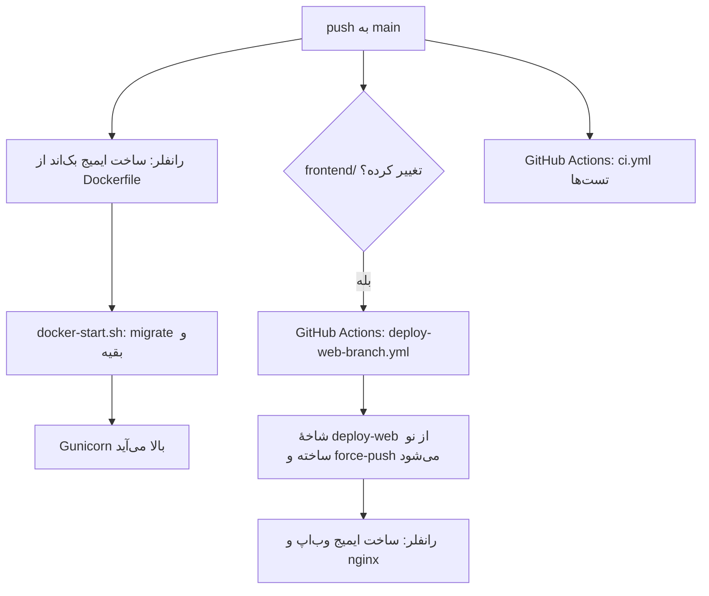

# ۸. دیپلوی

## سرویس‌های رانفلر

| سرویس | منبع | چه چیزی |
|---|---|---|
| بک‌اند | شاخهٔ `main`، فایل `Dockerfile` ریشهٔ مخزن | Django + Gunicorn؛ دامنه‌های `api.pharmenta.ir`، `pharmenta.ir`، `www.pharmenta.ir` |
| وب‌اپ | شاخهٔ `deploy-web` (ساختهٔ خودکار GitHub Actions) | nginx با خروجی وب Expo؛ دامنهٔ `app.pharmenta.ir` |
| Postgres | سرویس دیتابیس رانفلر | دیتابیس اصلی |
| MySQL | — | نسخهٔ کپی UpToDate (`UPTODATE_MYSQL_URL`) |
| دیسک سرویس بک‌اند | — | فایل‌های Lexicomp (`LEXICOMP_DB_DIR`) |
| Object Storage | باکت `pharmenta-dl` روی `https://s3-pish.runflare.cloud`؛ دانلود اپ از `https://s3.pharmenta.ir` | بسته‌های آفلاین |
| DNS | DNS رانفلر | رکوردهای `pharmenta.ir` |

رانفلر سرویس را از `Dockerfile` ریشهٔ شاخهٔ انتخاب‌شده می‌سازد و نمی‌شود فایل دیگری را به آن معرفی کرد. برای همین وب‌اپ شاخهٔ جدای `deploy-web` دارد که در آن `Dockerfile.frontend` جای `Dockerfile` نشسته است.

## جریان دیپلوی



### بک‌اند

`Dockerfile`:
1. ایمیج پایه `python:3.11-slim` به‌علاوهٔ `postgresql-client` (برای `pg_dump`).
2. نصب `backend/requirements.txt`.
3. کپی `backend/`.
4. `collectstatic` زیر تنظیمات local.
5. متغیرهای ایمیج: `DJANGO_SETTINGS_MODULE=config.settings.production`، `SECURE_SSL_REDIRECT=False` و `SECURE_HSTS_SECONDS=0`.

هنگام شروع کانتینر، `backend/docker-start.sh` به ترتیب `migrate`، `ensure_uptodate_search_index`، `createcachetable`، `load_atc_reference`، `seed_website` و `collectstatic` را زیر تنظیمات production اجرا می‌کند و بعد Gunicorn را روی `0.0.0.0:$PORT` (پیش‌فرض 8000) بالا می‌آورد. هر قدم پیش از اجرا در لاگ اعلام می‌شود (`[docker-start] >>> ...`). اگر قدمی شکست بخورد، کانتینر با همان کد خطا خارج می‌شود و آخرین سطر لاگ قدم مقصر را نشان می‌دهد.

### وب‌اپ

با هر push به `main` که یکی از `frontend/**`، `Dockerfile.frontend`، `.dockerignore` یا خود فایل workflow را تغییر دهد، `.github/workflows/deploy-web-branch.yml` اجرا می‌شود:

1. `Dockerfile.frontend` را روی `Dockerfile` کپی می‌کند.
2. یک کامیت بی‌والد (orphan) با پیام `deploy-web: main@<sha> with Dockerfile.frontend as Dockerfile` می‌سازد.
3. آن را با `git push --force` روی `deploy-web` می‌فرستد.

شاخهٔ `deploy-web` را **هرگز دستی ویرایش نکنید**؛ با push بعدی بازنویسی می‌شود. برای ساخت دوباره بدون تغییر کد، workflow را از تب Actions گیت‌هاب دستی اجرا کنید (`workflow_dispatch`).

`Dockerfile.frontend`:
1. با Node 20 `npm ci` و `npx expo export --platform web` را اجرا می‌کند. `EXPO_PUBLIC_API_BASE_URL` پیش‌فرض `https://api.pharmenta.ir/api/v1` است.
2. خروجی را در `nginx:1.27-alpine` با `frontend/nginx.conf` قرار می‌دهد.

برای بررسی اینکه `deploy-web` به‌روز است:

```bash
git fetch origin
git log -1 --format='%h %s' origin/deploy-web        # باید main@<آخرین کامیت main که frontend را تغییر داده> باشد
git diff --stat main origin/deploy-web               # فقط Dockerfile باید فرق کند
```

## چک‌لیست هر دیپلوی

پیش از push:
- [ ] تست‌های بک‌اند و `npm run typecheck` سبزند.
- [ ] مایگریشن‌های تازه کامیت شده‌اند (`makemigrations --check`).
- [ ] اگر متغیر محیطی تازه لازم است، **پیش از push** در env سرویس بک‌اند رانفلر گذاشته شده است. بک‌اند بدون آن ممکن است بالا نیاید.
- [ ] اگر مایگریشن جدولی را حذف یا ستونی را اجباری می‌کند، بکاپ گرفته شده است.

بعد از دیپلوی:
- [ ] `curl -s https://api.pharmenta.ir/api/v1/ready/` پاسخ `"status": "ok"` می‌دهد.
- [ ] لاگ شروع کانتینر بدون `!!! FAILED` تمام شده است.
- [ ] `https://pharmenta.ir/` و `https://app.pharmenta.ir/` باز می‌شوند.
- [ ] اگر داده‌ای باید وارد شود (سؤال‌ها، مقاله‌ها)، دستورش در کنسول سرویس اجرا شده است ([07-data.md](07-data.md)).
- [ ] اگر اپ موبایل تغییر کرده، بیلد تازه ساخته و منتشر شده است (پایین‌تر).

## برگرداندن یک دیپلوی خراب

1. اگر پنل رانفلر برگشت به دیپلوی قبلی را دارد، سریع‌ترین راه همان است.
2. وگرنه کامیت خراب را برگردانید و push کنید: `git revert <sha> && git push`. شاخهٔ `deploy-web` هم خودکار از نو ساخته می‌شود.
3. **مایگریشن‌ها خودکار برنمی‌گردند.** اگر کامیت خراب مایگریشن داشت، پیش از revert در کنسول سرویس `python manage.py migrate <app> <مایگریشن قبلی>` را اجرا کنید، یا بکاپ را برگردانید.

## راه‌اندازی از صفر (یک بار)

این ترتیب برای ساختن دوبارهٔ کل زیرساخت است، مثلاً روی حساب تازه.

1. **Postgres:** سرویس دیتابیس را بسازید و رشتهٔ اتصال **داخلی** را بردارید (میزبان `<name>-service`، درگاه 5432). رشتهٔ **خارجی** برای کار از لپ‌تاپ است.
2. **بک‌اند:**
   - سرویس را از شاخهٔ `main` بسازید.
   - متغیرهای ستون «رانفلر» در [06-configuration.md](06-configuration.md) را بگذارید. دست‌کم این‌ها لازم‌اند: `SECRET_KEY`، `DATABASE_URL`، `CACHE_BACKEND`، `CACHE_LOCATION`، `CELERY_RUN_TASKS_IN_REQUEST`، `ASYNC_EMAIL_ENABLED`، `ALLOWED_HOSTS`، `CORS_ALLOWED_ORIGINS`، `CSRF_TRUSTED_ORIGINS`، `SMSIR_*`، `QUIZ_API_ENABLED`، `FLASHCARDS_API_ENABLED`.
   - اگر رانفلر health check می‌خواهد، مسیر `/api/v1/health/` را بدهید.
3. **دیسک بک‌اند:** یک دیسک (volume) به سرویس وصل کنید و `interact.db` و `info.json` Lexicomp را در آن بگذارید. مسیرش را در `LEXICOMP_DB_DIR` بنویسید.
4. **MySQL UpToDate:** دیتابیس MySQL را بسازید و `UPTODATE_MYSQL_URL` را تنظیم کنید. از لپ‌تاپ `migrate_uptodate_to_mysql` را اجرا کنید ([07-data.md](07-data.md#uptodate)).
5. **وب‌اپ:** سرویس را از شاخهٔ `deploy-web` بسازید. اگر شاخه هنوز نیست، workflow «Update deploy-web branch» را دستی اجرا کنید.
6. **دامنه‌ها:** ترتیب مهم است تا اپ از دسترس خارج نشود.
   1. `app.pharmenta.ir` را به سرویس وب‌اپ اضافه کنید، رکورد DNS را بسازید و صبر کنید تا گواهی SSL صادر شود و باز شود.
   2. `api.pharmenta.ir`، `pharmenta.ir` و `www.pharmenta.ir` را به سرویس بک‌اند اضافه کنید.
   3. `ALLOWED_HOSTS` را برای هاست‌های سایت تغییر ندهید؛ آن‌ها خودکار اضافه می‌شوند.
   4. بعد از اضافه کردن هر دامنه، صادرکنندهٔ گواهی SSL آن را بررسی کنید: `echo | openssl s_client -connect <دامنه>:443 -servername <دامنه> 2>/dev/null | openssl x509 -noout -issuer`. اگر صادرکننده `cert-manager.local` است، گواهی واقعی هنوز صادر نشده است ([09-operations.md](09-operations.md)، بخش «عیب‌یابی»).
7. **مدیر:** در کنسول سرویس بک‌اند، `python manage.py createsuperuser` را اجرا کنید.
8. **داده:** داروها، ماشین‌حساب، مقاله و سؤال را طبق [07-data.md](07-data.md) وارد کنید.
9. **فروش:** در کنسول `/manage/sales/`، پلن رایگان، پلن‌های پولی و درگاه پرداخت را بسازید ([11-admin-consoles.md](11-admin-consoles.md)).
10. **سایت:** متن برگه‌های «قوانین» و «حریم خصوصی» را در پنل بنویسید و منتشر کنید ([12-website.md](12-website.md)).
11. **بستهٔ آفلاین:**
    1. در Object Storage باکت خصوصی بسازید.
    2. متغیرهای `OFFLINE_*` را بگذارید.
    3. CORS را با `offline_bucket_cors` تنظیم کنید.
    4. بسته‌ها را بسازید و آپلود کنید ([07-data.md](07-data.md)، بخش «بستهٔ آفلاین UpToDate و Lexicomp»).
12. **IP خروجی:** اگر کلید sms.ir یا درگاه پرداخت به IP محدود است، IP خروجی سرور را در پنل آن‌ها ثبت کنید. کنسول فروش در «درگاه پرداخت ← IP خروجی» آن را نشان می‌دهد.

## اپ اندروید و iOS

اپ بومی با Expo EAS ساخته می‌شود (`frontend/eas.json`). اپ `expo-updates` ندارد، یعنی **هر تغییری در کد اپ به بیلد و انتشار تازه نیاز دارد**؛ نسخهٔ نصب‌شده روی گوشی‌ها خودش به‌روز نمی‌شود. وب‌اپ با هر دیپلوی فوراً به‌روز می‌شود.

| پروفایل | خروجی | کاربرد |
|---|---|---|
| `development` | development client، توزیع داخلی | توسعه روی گوشی (`npx expo start --dev-client`) |
| `preview` | APK، توزیع داخلی | آزمایش پیش از انتشار، روی API اصلی |
| `production` | APK برای arm64-v8a و armeabi-v7a | بازار، مایکت و دانلود مستقیم |
| `production-arm64` | APK فقط arm64-v8a | APK کوچک‌تر، اختیاری. روی گوشی‌هایی که اندروید ۳۲بیتی دارند (بعضی گوشی‌های ارزان) نصب نمی‌شود |
| `play` | app bundle (AAB) | Google Play؛ Play برای هر گوشی فقط بخش لازمش را می‌فرستد |

```bash
cd frontend
npx eas-cli login                                          # یک بار
npx eas-cli build --platform android --profile production
npx eas-cli build --platform android --profile play        # برای Google Play
npx eas-cli build --platform android --profile preview     # آزمایشی
```

**iOS:** فعلاً منتشر نمی‌شود (حساب Apple Developer هنوز گرفته نشده). کاربران iPhone از وب‌اپ (PWA) استفاده می‌کنند.

### حجم APK

APK نسخهٔ 0.1.0 ‏80.7 MB بود و ۳۷ مگابایتش کتابخانه‌های x86 و x86_64 بود که فقط در شبیه‌ساز به کار می‌آیند. `frontend/app.config.js` با پلاگین `expo-build-properties` این‌ها را تنظیم می‌کند:

- **معماری‌ها:** فقط معماری‌های ARM گوشی‌ها ساخته می‌شوند. فهرست از متغیر `ANDROID_ARCHS` در `env` هر پروفایل خوانده می‌شود و پیش‌فرضش `arm64-v8a,armeabi-v7a` است.
- **فشرده‌سازی کتابخانه‌ها:** با `ANDROID_COMPRESS_NATIVE_LIBS=1` کتابخانه‌های بومی فشرده داخل APK قرار می‌گیرند. این متغیر برای پروفایل‌های APK روشن است. پروفایل `play` آن را ندارد، چون Google Play خودش بسته را فشرده می‌کند.
- **R8 و منابع:** در بیلد release، ‏R8 کد Java/Kotlin استفاده‌نشده را حذف و کوچک می‌کند و منابع بی‌استفاده هم حذف می‌شوند.

**R8 را روی گوشی امتحان کنید.** R8 ممکن است کلاسی را که فقط با reflection صدا زده می‌شود حذف کند. اولین بیلد با این تنظیمات، و بعد از آن هر بیلدی که کتابخانهٔ بومی تازه‌ای دارد، باید پیش از انتشار روی یک گوشی واقعی امتحان شود:

- ورود
- دانلود و باز کردن بستهٔ آفلاین
- خواندن مقاله و باز کردن عکس
- ماشین‌حساب

اگر بیلدی در شروع بسته شد یا بخشی کار نکرد ولی همان کد در development درست بود، علت به احتمال زیاد R8 است. قاعدهٔ keep لازم را با `extraProguardRules` در همان پلاگین اضافه کنید.

### نسخه و انتشار

- **تنها منبع نسخه:** `version` در `frontend/app.json` است و به شکل SemVer نوشته می‌شود (`MAJOR.MINOR.PATCH`، مثل 1.4.2). عدد دوم و سوم باید کمتر از ۱۰۰ باشند.
- **versionCode:** `app.config.js` آن را از همان نسخه می‌سازد: `major×10000 + minor×100 + patch`. یعنی 0.1.0 می‌شود 100 و 1.4.2 می‌شود 10402. buildNumber در iOS هم همان رشتهٔ نسخه است.
- **بیلدهای قدیمی:** versionCode آن‌ها ۱ تا ۵ بود. چون 100 بزرگ‌تر است، نسخهٔ تازه روی آن‌ها نصب می‌شود.
- **بیلد دوباره:** بیلد دوبارهٔ یک نسخه همان versionCode را دارد و اندروید و فروشگاه‌ها آن را به‌روزرسانی حساب نمی‌کنند. برای رفع اشکال، یک patch تازه منتشر کنید.

```bash
cd frontend
npm run release -- patch --dry-run   # نسخهٔ بعدی و متن CHANGELOG را فقط نشان می‌دهد
npm run release -- patch             # یا minor یا major
```

`scripts/release.mjs`:

1. اگر تغییر کامیت‌نشده‌ای باشد، کار را شروع نمی‌کند.
2. نسخه را در `app.json`، `package.json` و `package-lock.json` بالا می‌برد.
3. از عنوان کامیت‌هایی که بعد از آخرین تگ `app-v*` آمده‌اند، یک بخش تازه بالای `frontend/CHANGELOG.md` می‌نویسد.
4. کامیت `Release app vX.Y.Z` و تگ `app-vX.Y.Z` را می‌سازد.
5. هیچ چیزی را push یا بیلد نمی‌کند و قدم‌های بعدی را چاپ می‌کند.

**انتشار اندروید، به این ترتیب:**

1. `npm run release -- patch` (یا minor یا major). اگر خواستید متن CHANGELOG را اصلاح کنید و کامیت را amend کنید (دستورش چاپ می‌شود).
2. `git push && git push origin app-vX.Y.Z`.
3. بیلد `production` (و `play` برای Google Play).
4. APK را روی گوشی امتحان کنید (بالا، بخش R8).
5. APK را در بازار و مایکت بارگذاری کنید. در پنل سایت، «پیوندهای دانلود» را به‌روز کنید: لینک مستقیم APK یا لینک فروشگاه. خود APK را در «رسانه» بارگذاری نکنید؛ رسانه در دیتابیس ذخیره می‌شود و حداکثر ۵ مگابایت می‌گیرد.
6. وقتی نسخه از همهٔ لینک‌ها در دسترس شد، در پنل سایت، «نسخه‌ها و دانلود ← نسخه‌های اپ»، نسخهٔ تازه را با تغییراتش ثبت کنید و «پیشنهاد به‌روزرسانی در اپ» را بزنید.

### پیام به‌روزرسانی داخل اپ

اپ هنگام باز شدن، و هنگام برگشتن به آن (حداکثر هر ۳۰ دقیقه یک بار)، `GET /api/v1/app/release/` را می‌پرسد ([05-api.md](05-api.md#نسخهٔ-اپ--app)). کد: `frontend/src/components/UpdatePrompt.tsx` و `backend/apps/website/api.py`.

- **کدام نسخه‌ها حساب می‌شوند:** فقط نسخه‌های پنل که پایدار و منتشرشده‌اند و «پیشنهاد به‌روزرسانی در اپ» دارند. ردیف‌های قدیمی و نسخهٔ نمونه‌ای که `seed_website` می‌سازد (1.2.0) به اپ نمی‌رسند.
- **اختیاری:** برگه‌ای پایین صفحه با شمارهٔ نسخه و تغییرات و دو دکمهٔ «به‌روزرسانی» و «بعداً». «بعداً» پیشنهاد همان نسخه را ۲۴ ساعت ساکت می‌کند.
- **اجباری:** «کمترین نسخهٔ قابل استفاده» را روی یک نسخه پر کنید. نسخه‌های قدیمی‌تر از آن روی صفحه‌ای می‌مانند که فقط دکمهٔ به‌روزرسانی دارد. سخت‌ترین حداقلِ همهٔ نسخه‌های اعلام‌شده حساب می‌شود؛ پس نسخهٔ بعدی که این فیلد را خالی می‌گذارد اجبار قبلی را برنمی‌دارد. برای برداشتن اجبار، فیلد را روی همان نسخه‌ای که آن را گذاشته خالی کنید.
- **دکمهٔ به‌روزرسانی:** به `https://pharmenta.ir/download/` (`SITE_PUBLIC_URL`) می‌رود که لینک همهٔ فروشگاه‌ها و APK را دارد.
- **نسخه‌های قدیمی:** نسخهٔ 0.1.0 و قبل از آن این پیام را ندارند. کاربرانشان را با اطلاعیه یا پیامک از نسخهٔ تازه باخبر کنید.
- **وب‌اپ:** وب‌اپ از این مسیر استفاده نمی‌کند. هنگام برگشتن به تب و هر ۳۰ دقیقه، فایل‌های اسکریپتی را که `index.html` روی سرور نام می‌برد با فایل‌های بارشده مقایسه می‌کند. اگر فرق داشتند، نوار «نسخهٔ تازهٔ فارمنتا آماده است» با دکمهٔ «بارگذاری دوباره» نشان داده می‌شود (`UpdatePrompt.web.tsx`).

### امنیت و هشدار نصب

تنظیم‌های `app.json` و `app.config.js`:

- **`allowBackup: false`:** داده‌های اپ در بکاپ گوگل و `adb backup` کپی نمی‌شوند. توکن‌های ورود به هر حال در `expo-secure-store` هستند.
- **`usesCleartextTraffic: false`:** بیلد release درخواست `http` ساده نمی‌فرستد؛ همهٔ نشانی‌ها `https` هستند. بیلد debug با manifest خودش اجازهٔ `http` دارد تا به Metro وصل شود.
- **`blockedPermissions`:** مجوزهایی که کتابخانه‌ها اضافه می‌کردند ولی اپ لازمشان ندارد حذف شده‌اند:
  - `SYSTEM_ALERT_WINDOW`
  - `READ_EXTERNAL_STORAGE` و `WRITE_EXTERNAL_STORAGE`
  - `RECORD_AUDIO`
  - `USE_BIOMETRIC` و `USE_FINGERPRINT`
  - `DUMP`

  مجوزهای مانده:
  - `INTERNET` و `VIBRATE`
  - دانلود پس‌زمینهٔ بستهٔ آفلاین: `ACCESS_NETWORK_STATE`، `FOREGROUND_SERVICE` و `FOREGROUND_SERVICE_DATA_SYNC`، `WAKE_LOCK`، `RUN_USER_INITIATED_JOBS`، `DOWNLOAD_WITHOUT_NOTIFICATION`

  اگر فروشگاهی برای سرویس پیش‌زمینه توضیح خواست، کاربردش «همگام‌سازی داده (data sync) برای دانلود محتوای آفلاین» است.
- **هشدار Play Protect:** گوگل برای APKی که بیرون از Google Play نصب می‌شود و امضای ناشناخته یا نصب کمی دارد، گاهی هشدار «اپ ناشناخته» یا «ناامن» نشان می‌دهد. با بیشتر شدن نصب‌ها و انتشار در Google Play این هشدار معمولاً برطرف می‌شود. اگر هشدار «مضر» ماند، از فرم اعتراض Play Protect گوگل درخواست بررسی بدهید. امضای ثابت، مجوزهای کم و `targetSdk` به‌روز (36، پیش‌فرض Expo SDK 57) هم احتمال هشدار را کم می‌کنند.

### کلید امضا

EAS کلید امضای اندروید (keystore) را نگه می‌دارد. همهٔ نسخه‌های بعدی باید با همین کلید امضا شوند. **بدون آن، به‌روزرسانی اپ در بازار و مایکت منتشر نمی‌شود و روی نسخهٔ نصب‌شدهٔ کاربران هم نصب نمی‌شود.**

1. یک بار در `frontend/` دستور `npx eas-cli credentials -p android` را اجرا کنید. پروفایل `production` را انتخاب کنید، بعد بخش Keystore و گزینهٔ دانلود آن را. یک فایل `.jks` دانلود می‌شود و رمز keystore، alias و رمز key چاپ می‌شوند.
2. فایل و رمزها را در یک مدیر رمز یا دیسک رمزگذاری‌شده، بیرون از مخزن، نگه دارید. `.gitignore` فایل‌های `*.jks`، `*.keystore`، `credentials.json` و کلید service account گوگل را راه نمی‌دهد. جای آن را در [09-operations.md](09-operations.md#رازها-و-چیزهایی-که-باید-امن-نگه-داشته-شوند) ثبت کنید.
3. **Google Play:** Play App Signing به‌طور پیش‌فرض یک کلید تازهٔ گوگل می‌سازد. در آن صورت APK گوگل‌پلی و APK بازار امضای متفاوت دارند و کاربر نمی‌تواند نسخهٔ یکی را روی دیگری به‌روز کند. هنگام ثبت اپ، گزینهٔ استفاده از کلید موجود را بزنید و همین keystore را بدهید (Play برای این کار ابزار PEPK را می‌دهد).

## CI

`.github/workflows/ci.yml` روی هر push به `main` و هر Pull Request اجرا می‌شود:

| کار | قدم‌ها |
|---|---|
| `backend` | Postgres 16 و Redis 7؛ نصب وابستگی‌ها؛ `manage.py check`؛ `check --deploy --settings=config.settings.production`؛ `makemigrations --check --dry-run`؛ `backup_database --dry-run`؛ `manage.py test --verbosity=2 --timing` |
| `frontend` | Node 20؛ `npm ci`؛ `npm run typecheck`؛ `npm run build:web` |

CI جلوی دیپلوی را نمی‌گیرد؛ رانفلر مستقل از نتیجهٔ CI می‌سازد. پیش از push خودتان تست‌ها را اجرا کنید.

## پیکربندی‌های دیگر مخزن

این فایل‌ها در دیپلوی فعلی استفاده نمی‌شوند، ولی نگه داشته شده‌اند:

| فایل | کاربرد |
|---|---|
| `docker-compose.yml` | اجرای کامل محلی با Redis و worker ([02-local-setup.md](02-local-setup.md#اجرای-کامل-با-docker)) |
| `backend/Dockerfile` | همان ایمیج بک‌اند با `backend/` به‌عنوان context (برای `docker-compose`) |
| `backend/render.yaml`، `backend/build.sh`، `backend/release.sh`، `backend/Procfile` | میزبان‌هایی که مرحلهٔ build و release جدا دارند (Render، Heroku-مانند). بک‌اند قبلاً مدتی روی Render بود |
| `EXPO_BASE_URL` در `app.config.js` | سرو وب‌اپ زیر یک زیرمسیر، مثل GitHub Pages |
