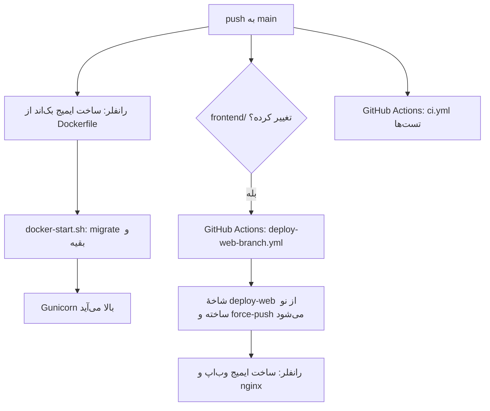

# ۸. دیپلوی

## سرویس‌های رانفلر

| سرویس | منبع | چه چیزی |
|---|---|---|
| بک‌اند | شاخهٔ `main`، فایل `Dockerfile` ریشهٔ مخزن | Django + Gunicorn؛ دامنه‌های `api.pharmenta.ir`، `pharmenta.ir`، `www.pharmenta.ir` |
| وب‌اپ | شاخهٔ `deploy-web` (ساختهٔ خودکار GitHub Actions) | nginx با خروجی وب Expo؛ دامنهٔ `app.pharmenta.ir` |
| Postgres | سرویس دیتابیس رانفلر | دیتابیس اصلی |
| MySQL | — | نسخهٔ کپی UpToDate (`UPTODATE_MYSQL_URL`) |
| دیسک سرویس بک‌اند | — | فایل‌های Lexicomp (`LEXICOMP_DB_DIR`) |
| Object Storage | باکت `pharmenta-dl` روی `https://s3-pish.runflare.cloud`؛ دانلود اپ از `https://s3.pharmenta.ir` | بسته‌های آفلاین |
| DNS | DNS رانفلر | رکوردهای `pharmenta.ir` |

رانفلر سرویس را از `Dockerfile` ریشهٔ شاخهٔ انتخاب‌شده می‌سازد و نمی‌شود فایل دیگری را به آن معرفی کرد. برای همین وب‌اپ شاخهٔ جدای `deploy-web` دارد که در آن `Dockerfile.frontend` جای `Dockerfile` نشسته است.

## جریان دیپلوی



### بک‌اند

`Dockerfile`:
1. ایمیج پایه `python:3.11-slim` به‌علاوهٔ `postgresql-client` (برای `pg_dump`).
2. نصب `backend/requirements.txt`.
3. کپی `backend/`.
4. `collectstatic` زیر تنظیمات local.
5. متغیرهای ایمیج: `DJANGO_SETTINGS_MODULE=config.settings.production`، `SECURE_SSL_REDIRECT=False` و `SECURE_HSTS_SECONDS=0`.

هنگام شروع کانتینر، `backend/docker-start.sh` به ترتیب `migrate`، `ensure_uptodate_search_index`، `createcachetable`، `load_atc_reference`، `seed_website` و `collectstatic` را زیر تنظیمات production اجرا می‌کند و بعد Gunicorn را روی `0.0.0.0:$PORT` (پیش‌فرض 8000) بالا می‌آورد. هر قدم پیش از اجرا در لاگ اعلام می‌شود (`[docker-start] >>> ...`). اگر قدمی شکست بخورد، کانتینر با همان کد خطا خارج می‌شود و آخرین سطر لاگ قدم مقصر را نشان می‌دهد.

### وب‌اپ

با هر push به `main` که یکی از `frontend/**`، `Dockerfile.frontend`، `.dockerignore` یا خود فایل workflow را تغییر دهد، `.github/workflows/deploy-web-branch.yml` اجرا می‌شود:

1. `Dockerfile.frontend` را روی `Dockerfile` کپی می‌کند.
2. یک کامیت بی‌والد (orphan) با پیام `deploy-web: main@<sha> with Dockerfile.frontend as Dockerfile` می‌سازد.
3. آن را با `git push --force` روی `deploy-web` می‌فرستد.

شاخهٔ `deploy-web` را **هرگز دستی ویرایش نکنید**؛ با push بعدی بازنویسی می‌شود. برای ساخت دوباره بدون تغییر کد، workflow را از تب Actions گیت‌هاب دستی اجرا کنید (`workflow_dispatch`).

`Dockerfile.frontend`:
1. با Node 20 `npm ci` و `npx expo export --platform web` را اجرا می‌کند. `EXPO_PUBLIC_API_BASE_URL` پیش‌فرض `https://api.pharmenta.ir/api/v1` است.
2. خروجی را در `nginx:1.27-alpine` با `frontend/nginx.conf` قرار می‌دهد.

برای بررسی اینکه `deploy-web` به‌روز است:

```bash
git fetch origin
git log -1 --format='%h %s' origin/deploy-web        # باید main@<آخرین کامیت main که frontend را تغییر داده> باشد
git diff --stat main origin/deploy-web               # فقط Dockerfile باید فرق کند
```

## چک‌لیست هر دیپلوی

پیش از push:
- [ ] تست‌های بک‌اند و `npm run typecheck` سبزند.
- [ ] مایگریشن‌های تازه کامیت شده‌اند (`makemigrations --check`).
- [ ] اگر متغیر محیطی تازه لازم است، **پیش از push** در env سرویس بک‌اند رانفلر گذاشته شده است. بک‌اند بدون آن ممکن است بالا نیاید.
- [ ] اگر مایگریشن جدولی را حذف یا ستونی را اجباری می‌کند، بکاپ گرفته شده است.

بعد از دیپلوی:
- [ ] `curl -s https://api.pharmenta.ir/api/v1/ready/` پاسخ `"status": "ok"` می‌دهد.
- [ ] لاگ شروع کانتینر بدون `!!! FAILED` تمام شده است.
- [ ] `https://pharmenta.ir/` و `https://app.pharmenta.ir/` باز می‌شوند.
- [ ] اگر داده‌ای باید وارد شود (سؤال‌ها، مقاله‌ها)، دستورش در کنسول سرویس اجرا شده است ([07-data.md](07-data.md)).
- [ ] اگر اپ موبایل تغییر کرده، بیلد تازه ساخته و منتشر شده است (پایین‌تر).

## برگرداندن یک دیپلوی خراب

1. اگر پنل رانفلر برگشت به دیپلوی قبلی را دارد، سریع‌ترین راه همان است.
2. وگرنه کامیت خراب را برگردانید و push کنید: `git revert <sha> && git push`. شاخهٔ `deploy-web` هم خودکار از نو ساخته می‌شود.
3. **مایگریشن‌ها خودکار برنمی‌گردند.** اگر کامیت خراب مایگریشن داشت، پیش از revert در کنسول سرویس `python manage.py migrate <app> <مایگریشن قبلی>` را اجرا کنید، یا بکاپ را برگردانید.

## راه‌اندازی از صفر (یک بار)

این ترتیب برای ساختن دوبارهٔ کل زیرساخت است، مثلاً روی حساب تازه.

1. **Postgres:** سرویس دیتابیس را بسازید و رشتهٔ اتصال **داخلی** را بردارید (میزبان `<name>-service`، درگاه 5432). رشتهٔ **خارجی** برای کار از لپ‌تاپ است.
2. **بک‌اند:**
   - سرویس را از شاخهٔ `main` بسازید.
   - متغیرهای ستون «رانفلر» در [06-configuration.md](06-configuration.md) را بگذارید. دست‌کم این‌ها لازم‌اند: `SECRET_KEY`، `DATABASE_URL`، `CACHE_BACKEND`، `CACHE_LOCATION`، `CELERY_RUN_TASKS_IN_REQUEST`، `ASYNC_EMAIL_ENABLED`، `ALLOWED_HOSTS`، `CORS_ALLOWED_ORIGINS`، `CSRF_TRUSTED_ORIGINS`، `SMSIR_*`، `QUIZ_API_ENABLED`، `FLASHCARDS_API_ENABLED`.
   - اگر رانفلر health check می‌خواهد، مسیر `/api/v1/health/` را بدهید.
3. **دیسک بک‌اند:** یک دیسک (volume) به سرویس وصل کنید و `interact.db` و `info.json` Lexicomp را در آن بگذارید. مسیرش را در `LEXICOMP_DB_DIR` بنویسید.
4. **MySQL UpToDate:** دیتابیس MySQL را بسازید و `UPTODATE_MYSQL_URL` را تنظیم کنید. از لپ‌تاپ `migrate_uptodate_to_mysql` را اجرا کنید ([07-data.md](07-data.md#uptodate)).
5. **وب‌اپ:** سرویس را از شاخهٔ `deploy-web` بسازید. اگر شاخه هنوز نیست، workflow «Update deploy-web branch» را دستی اجرا کنید.
6. **دامنه‌ها:** ترتیب مهم است تا اپ از دسترس خارج نشود.
   1. `app.pharmenta.ir` را به سرویس وب‌اپ اضافه کنید، رکورد DNS را بسازید و صبر کنید تا گواهی SSL صادر شود و باز شود.
   2. `api.pharmenta.ir`، `pharmenta.ir` و `www.pharmenta.ir` را به سرویس بک‌اند اضافه کنید.
   3. `ALLOWED_HOSTS` را برای هاست‌های سایت تغییر ندهید؛ آن‌ها خودکار اضافه می‌شوند.
   4. بعد از اضافه کردن هر دامنه، صادرکنندهٔ گواهی SSL آن را بررسی کنید: `echo | openssl s_client -connect <دامنه>:443 -servername <دامنه> 2>/dev/null | openssl x509 -noout -issuer`. اگر صادرکننده `cert-manager.local` است، گواهی واقعی هنوز صادر نشده است ([09-operations.md](09-operations.md)، بخش «عیب‌یابی»).
7. **مدیر:** در کنسول سرویس بک‌اند، `python manage.py createsuperuser` را اجرا کنید.
8. **داده:** داروها، ماشین‌حساب، مقاله و سؤال را طبق [07-data.md](07-data.md) وارد کنید.
9. **فروش:** در کنسول `/ops/`، پلن رایگان، پلن‌های پولی و درگاه پرداخت را بسازید ([11-admin-consoles.md](11-admin-consoles.md)).
10. **سایت:** متن برگه‌های «قوانین» و «حریم خصوصی» را در پنل بنویسید و منتشر کنید ([12-website.md](12-website.md)).
11. **بستهٔ آفلاین:**
    1. در Object Storage باکت خصوصی بسازید.
    2. متغیرهای `OFFLINE_*` را بگذارید.
    3. CORS را با `offline_bucket_cors` تنظیم کنید.
    4. بسته‌ها را بسازید و آپلود کنید ([07-data.md](07-data.md)، بخش «بستهٔ آفلاین UpToDate و Lexicomp»).
12. **IP خروجی:** اگر کلید sms.ir یا درگاه پرداخت به IP محدود است، IP خروجی سرور را در پنل آن‌ها ثبت کنید. کنسول فروش در «درگاه پرداخت ← IP خروجی» آن را نشان می‌دهد.

## اپ اندروید و iOS

اپ بومی با Expo EAS ساخته می‌شود (`frontend/eas.json`). اپ `expo-updates` ندارد، یعنی **هر تغییری در کد اپ به بیلد و انتشار تازه نیاز دارد**؛ نسخهٔ نصب‌شده روی گوشی‌ها خودش به‌روز نمی‌شود. وب‌اپ با هر دیپلوی فوراً به‌روز می‌شود.

| پروفایل | خروجی | کاربرد |
|---|---|---|
| `development` | development client، توزیع داخلی | توسعه روی گوشی (`npx expo start --dev-client`) |
| `preview` | APK، توزیع داخلی | آزمایش پیش از انتشار |
| `production` | APK، افزایش خودکار `versionCode` | انتشار |

```bash
cd frontend
eas login                                               # یک بار
eas build --platform android --profile production
eas build --platform android --profile preview          # آزمایشی
eas build --platform ios --profile production           # فعلاً منتشر نمی‌شود
```

- **نسخه:** `appVersionSource` روی `local` است؛ یعنی `version` و `android.versionCode` از `app.json` خوانده می‌شوند. پروفایل `production` با `autoIncrement` آن را بالا می‌برد. تغییر `app.json` را بعد از بیلد کامیت کنید تا شمارهٔ نسخه عقب نرود.
- **انتشار اندروید:**
  1. APK را از صفحهٔ بیلد EAS دانلود کنید.
  2. در بازار و مایکت بارگذاری کنید.
  3. در پنل سایت، در «نسخه‌ها و دانلود»، نسخهٔ تازه و لینک مستقیم یا لینک فروشگاه را بگذارید. خود APK را در «رسانه» بارگذاری نکنید؛ رسانه در دیتابیس ذخیره می‌شود و حداکثر ۵ مگابایت می‌گیرد.
- **iOS:** فعلاً منتشر نمی‌شود و کاربران iPhone از وب‌اپ (PWA) استفاده می‌کنند.
- **مجوزها:** دانلود پس‌زمینهٔ بستهٔ آفلاین روی اندروید از سرویس پیش‌زمینه (foreground service) استفاده می‌کند. اگر فروشگاهی برای آن توضیح خواست، کاربردش «همگام‌سازی داده (data sync) برای دانلود محتوای آفلاین» است.
- **کلید امضا:** EAS کلید امضای اندروید (keystore) را نگه می‌دارد. یک نسخهٔ پشتیبان از آن بگیرید (`eas credentials`)؛ بدون همان کلید نمی‌شود به‌روزرسانی اپ را در بازار و مایکت منتشر کرد ([09-operations.md](09-operations.md#رازها-و-چیزهایی-که-باید-امن-نگه-داشته-شوند)).

## CI

`.github/workflows/ci.yml` روی هر push به `main` و هر Pull Request اجرا می‌شود:

| کار | قدم‌ها |
|---|---|
| `backend` | Postgres 16 و Redis 7؛ نصب وابستگی‌ها؛ `manage.py check`؛ `check --deploy --settings=config.settings.production`؛ `makemigrations --check --dry-run`؛ `backup_database --dry-run`؛ `manage.py test --verbosity=2 --timing` |
| `frontend` | Node 20؛ `npm ci`؛ `npm run typecheck`؛ `npm run build:web` |

CI جلوی دیپلوی را نمی‌گیرد؛ رانفلر مستقل از نتیجهٔ CI می‌سازد. پیش از push خودتان تست‌ها را اجرا کنید.

## پیکربندی‌های دیگر مخزن

این فایل‌ها در دیپلوی فعلی استفاده نمی‌شوند، ولی نگه داشته شده‌اند:

| فایل | کاربرد |
|---|---|
| `docker-compose.yml` | اجرای کامل محلی با Redis و worker ([02-local-setup.md](02-local-setup.md#اجرای-کامل-با-docker)) |
| `backend/Dockerfile` | همان ایمیج بک‌اند با `backend/` به‌عنوان context (برای `docker-compose`) |
| `backend/render.yaml`، `backend/build.sh`، `backend/release.sh`، `backend/Procfile` | میزبان‌هایی که مرحلهٔ build و release جدا دارند (Render، Heroku-مانند). بک‌اند قبلاً مدتی روی Render بود |
| `EXPO_BASE_URL` در `app.config.js` | سرو وب‌اپ زیر یک زیرمسیر، مثل GitHub Pages |
