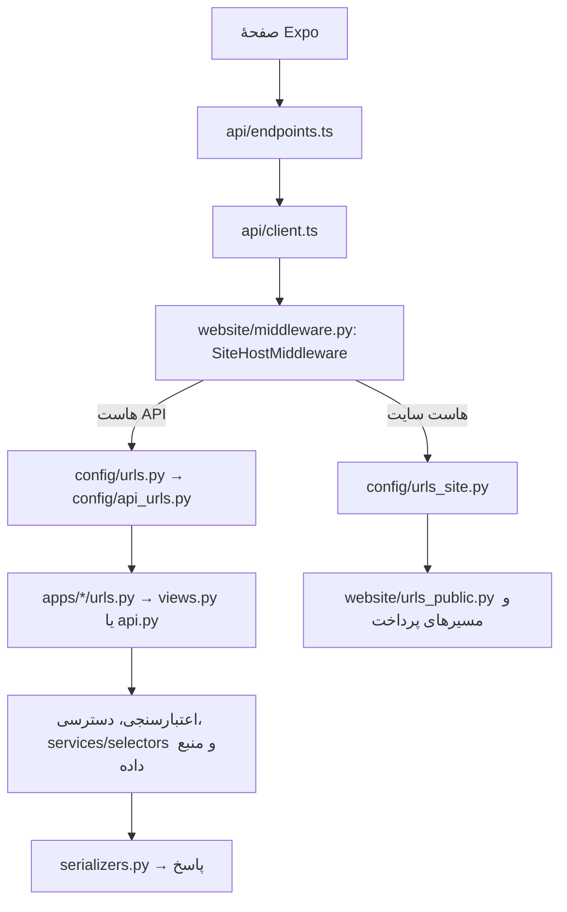
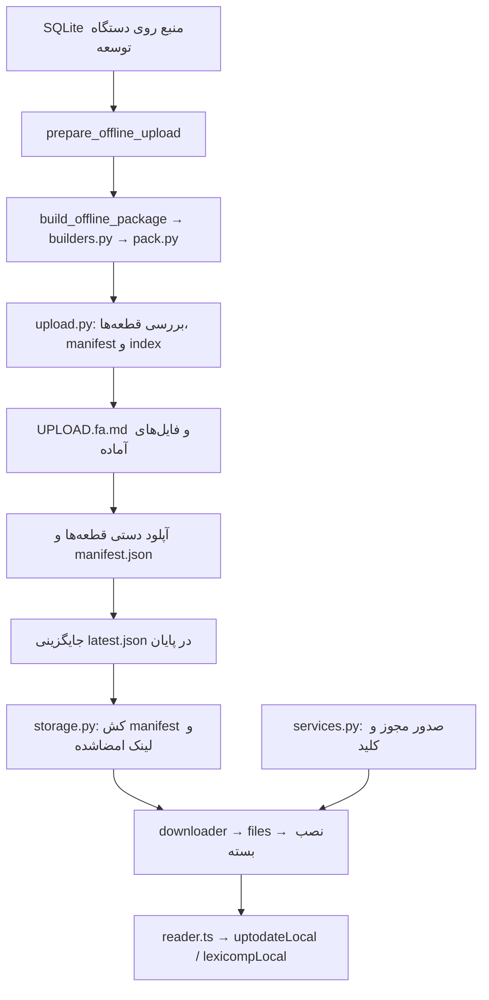

# ۱۶. نقشهٔ فایل‌ها و جریان اجرای پروژه

مبنای این نقشه، کد محلی در ۲۰۲۶-۱۱-۰۷ و آخرین کامیت کد `2c801b9` است. مسیرها نسبت به ریشهٔ مخزن‌اند. این سند رفتار پیاده‌سازی‌شده را توضیح می‌دهد؛ وضعیت سرویس زنده و انتشار فایل‌های بیرون از Git باید جداگانه بررسی شود.

## شروع اپ و انتخاب صفحه

```text
frontend/index.js
  → App.tsx
    → ثبت Service Worker و آماده‌سازی نصب PWA
    → SafeAreaProvider → ThemeProvider → LanguageProvider
    → PersistQueryClientProvider → Gate
      → آماده‌سازی فونت، تم و زبان
      → useAuth.hydrate() و useOfflineBoot()
      → TourProvider → Navigator + TourOverlay + UpdatePrompt
```

[App.tsx](../frontend/App.tsx) شروع اپ را هماهنگ می‌کند. [store/auth.ts](../frontend/src/store/auth.ts) و [store/session.ts](../frontend/src/store/session.ts) نشست را بازیابی می‌کنند. [Navigator.tsx](../frontend/src/navigation/Navigator.tsx) به ترتیب وضعیت بارگذاری، خروج از حساب، نیاز به انتخاب رمز و آنبوردینگ را بررسی می‌کند و سپس صفحهٔ جاری را داخل `AppShell` با نوار پایین نشان می‌دهد.

صفحه‌ها در [screens/](../frontend/src/screens/) هستند. وضعیت مسیرها در [store/nav.ts](../frontend/src/store/nav.ts)، نوع مسیرها در [navigation/types.ts](../frontend/src/navigation/types.ts) و رفتار برگشت در [navigation/back.ts](../frontend/src/navigation/back.ts) تعریف می‌شود. پیاده‌سازی فعلی ناوبری، ماشین حالت داخلی اپ است.

## درخواست آنلاین و انتخاب مسیر در بک‌اند



- [api/types.ts](../frontend/src/api/types.ts) قرارداد TypeScript و [api/endpoints.ts](../frontend/src/api/endpoints.ts) فراخوانی‌ها را نگه می‌دارند. [api/client.ts](../frontend/src/api/client.ts) هدر Bearer را اضافه می‌کند؛ در 401 تمدید توکن را میان درخواست‌های هم‌زمان مشترک می‌کند و درخواست را یک بار با توکن تازه تکرار می‌کند.
- [api/queryClient.ts](../frontend/src/api/queryClient.ts) کش و ذخیرهٔ پاسخ‌ها را مدیریت می‌کند. پیش‌فرض تازگی ۵ دقیقه و حداکثر عمر ذخیره ۷ روز است؛ برخی کلیدها تنظیم اختصاصی دارند. داشتن پاسخ کش‌شده با نصب بستهٔ آفلاین یکسان نیست.
- [SiteHostMiddleware](../backend/apps/website/middleware.py) درخواست‌های `SITE_HOSTS` را به [urls_site.py](../backend/config/urls_site.py) می‌فرستد. API نسخه‌دار از [urls.py](../backend/config/urls.py) به [api_urls.py](../backend/config/api_urls.py) و سپس روتر هر اپ می‌رسد.
- ابزارهای مدیریت روی هاست API زیر `/manage/` قرار دارند: خانه و دسترسی در [apps/manage/](../backend/apps/manage/)، محتوا در [website/panel/](../backend/apps/website/panel/)، فروش در [billing/console/](../backend/apps/billing/console/)، اعلانات در [announcements/manage_urls.py](../backend/apps/announcements/manage_urls.py) و کیفیت داده در [data_quality_center/](../backend/apps/data_quality_center/).
- احراز هویت API در [accounts/authentication.py](../backend/apps/accounts/authentication.py)، کنترل محتوای فروشی در [billing/enforcement.py](../backend/apps/billing/enforcement.py)، محدودیت نرخ در [core/throttling.py](../backend/apps/core/throttling.py) و تنظیم مدیریتی آن در [core/ratelimit.py](../backend/apps/core/ratelimit.py) است. قالب خطا در [core/exceptions.py](../backend/apps/core/exceptions.py) تعریف می‌شود.

جزئیات قراردادها در [05-api.md](05-api.md) و تنظیمات در [06-configuration.md](06-configuration.md) است.

## خرید از اپ و بازگشت درگاه

[PlansScreen.tsx](../frontend/src/screens/PlansScreen.tsx) کاتالوگ، قیمت و پیش‌فاکتور را از API می‌گیرد. `CheckoutView` در [billing/views.py](../backend/apps/billing/views.py) سفارش حساب واردشده را می‌سازد و `payment_url` برمی‌گرداند. این نشانی به `pay_start` روی سایت می‌رسد؛ پرداخت در مرورگر و با درگاه انتخاب‌شده انجام می‌شود. بازگشت درگاه از مسیرهای [urls_site.py](../backend/config/urls_site.py) به `payment_callback` می‌رسد و منطق [billing/services.py](../backend/apps/billing/services.py) پرداخت و حق دسترسی را ثبت می‌کند. سفارش با مبلغ نهایی صفر همان‌جا در checkout پرداخت‌شده می‌شود و URL پرداخت ندارد.

خرید پلن داخل اپ با پرداخت در مرورگر دو مرحلهٔ همین جریان‌اند؛ باز شدن مرورگر به معنی نیاز به خرید دوباره از صفحهٔ پلن‌های سایت نیست.

## جست‌وجوی فعلی UpToDate

```text
screens/UptodateScreen.tsx
  → offline/sources.ts: uptodateSource.searchPage
    → بسته و مجوز معتبر: uptodateLocal.ts → uptodateSearchCatalog.ts
    → مسیر آنلاین: api/endpoints.ts
      → GET /api/v1/uptodate/topics/?search=...&paged=1
      → uptodate/views.py: TopicSearchView
      → uptodate/services.py: search_page
      → uptodate/search_catalog.py: SearchCatalog
      → مفهوم و ارتباط مقاله‌های snapshot، با مسیر پشتیبان عنوان
```

[search_catalog.py](../backend/apps/uptodate/search_catalog.py) و [uptodateSearchCatalog.ts](../frontend/src/offline/uptodateSearchCatalog.ts) مفهوم، نام‌های جایگزین، فهرست مقاله‌ها برای مخاطب عمومی/بزرگسال/کودک/آموزش بیمار و پیشنهادهای جست‌وجو را پیاده می‌کنند. مسیر پشتیبان عنوان و تصحیح املا در [services.py](../backend/apps/uptodate/services.py) و [uptodateLocal.ts](../frontend/src/offline/uptodateLocal.ts) است.

پاسخ صفحه‌بندی‌شده شامل نتایج، تعداد کل، تخصص‌ها، عبارت تصحیح‌شده و پیشنهادهاست. [UptodateSuggestionMenu.tsx](../frontend/src/components/UptodateSuggestionMenu.tsx) از همین پاسخ استفاده می‌کند؛ شمارندهٔ هر پیشنهاد تعداد مقاله‌های معتبر مربوط به همان مفهوم و مخاطب است. فیلتر تخصص می‌تواند با هرکدام از تخصص‌های مقاله تطبیق کند.

در این مسیر بدنهٔ مقاله جست‌وجو نمی‌شود، embedding اجرا نمی‌شود و Elasticsearch فراخوانی نمی‌شود. فایل‌های [search_concepts.py](../backend/apps/uptodate/search_concepts.py)، [search_hierarchy.py](../backend/apps/uptodate/search_hierarchy.py) و [search_request.py](../backend/apps/uptodate/search_request.py) را با زنجیرهٔ عملیاتی بالا یکی نگیرید. آن‌ها زیرساخت واژه‌نامه، ساختار و عمق درخواست‌اند؛ طرح توسعه و فازهای متوقف‌شده در [search/README.md](search/README.md) مشخص است.

## باز کردن مقاله، مقصد جست‌وجو و جدول

- مسیر عادی از صفحه‌های UpToDate به `uptodateSource.topic` و سپس بستهٔ محلی یا `TopicDetailView` می‌رود. سرور در [uptodate/services.py](../backend/apps/uptodate/services.py) MySQL را در صورت تنظیم `UPTODATE_MYSQL_URL` انتخاب می‌کند و در غیر این صورت SQLite را می‌خواند.
- [TopicDetailView](../backend/apps/uptodate/views.py) دسترسی و مصرف سهمیهٔ مقاله را اعمال می‌کند. عنوان در پاسخ متن ساده است و بدنه و outline به شکل HTML حفظ می‌شوند.
- `uptodateSource.topicAtAnchor` برای تطبیق نسخه و مقصد ابتدا API را صدا می‌زند. سرور hash بدنه و شناسهٔ پاراگراف را با [search_extraction.py](../backend/apps/uptodate/search_extraction.py) بررسی می‌کند و `matched`، `missing` یا `stale` می‌دهد. خطای شبکه یا 503 به خواندن عادی مقاله برمی‌گردد؛ این بازگشت تطبیق مقصد را تأیید نمی‌کند.
- [UptodateArticleScreen.tsx](../frontend/src/screens/UptodateArticleScreen.tsx) و [MedscapeArticleScreen.tsx](../frontend/src/screens/MedscapeArticleScreen.tsx) wrapperهای [ClinicalArticleReader.tsx](../frontend/src/components/article/ClinicalArticleReader.tsx) هستند؛ خوانندهٔ مشترک HTML و پل ارتباطی iframe/WebView را نگه می‌دارد. ساختار Medscape از [medscapeReader.ts](../frontend/src/utils/medscapeReader.ts) تبدیل می‌شود. فهرست مشترک در [ClinicalArticleOutline.tsx](../frontend/src/components/article/ClinicalArticleOutline.tsx) است. [uptodateTables.ts](../frontend/src/utils/uptodateTables.ts) کنترل جدول را اضافه می‌کند. لمس جدول یا لینک جدول در Related مستقیماً نمایشگر تمام‌صفحه را باز می‌کند؛ بستن، به مقاله برمی‌گردد.
- علاقه‌مندی‌ها و هایلایت‌ها در [store/library.ts](../frontend/src/store/library.ts) با کلید `pharmenta.library` روی دستگاه ذخیره می‌شوند و به سرور ارسال نمی‌شوند.

## ساخت، انتشار و خواندن بستهٔ آفلاین



[prepare_offline_upload.py](../backend/apps/offline/management/commands/prepare_offline_upload.py) دستور هماهنگ‌کننده و [upload.py](../backend/apps/offline/upload.py) بررسی‌کنندهٔ خروجی است. `--existing` مرحلهٔ ساخت را رد می‌کند. قالب و رمزنگاری در [pack.py](../backend/apps/offline/pack.py)، تبدیل منبع به رکورد و index در [builders.py](../backend/apps/offline/builders.py)، انتشار manifest و URL در [storage.py](../backend/apps/offline/storage.py)، و مجوز در [services.py](../backend/apps/offline/services.py) است. کش manifest سرور ۳۰۰ ثانیه است.

در کلاینت، [store.ts](../frontend/src/offline/store.ts) وضعیت نصب، دانلود و مجوز را نگه می‌دارد؛ `files.ts`، `crypto.ts` و `downloader.ts` نسخهٔ بومی و فایل‌های هم‌نام `.web.ts` نسخهٔ مرورگرند. قطعه‌ها روی گوشی در فضای خصوصی اپ و در وب در OPFS قرار دارند.

[sources.ts](../frontend/src/offline/sources.ts) ابتدا بستهٔ قابل استفاده را می‌خواند؛ شکست خواندن یا نبود رکورد به API منتقل می‌شود. مکمل [uptodateSearchSupplement.ts](../frontend/src/offline/uptodateSearchSupplement.ts) برای افزودن نگاشت جست‌وجو به بسته‌های قدیمی است. بسته‌های تازهٔ `search_schema: 1` این نگاشت را داخل index دارند.

با عوض شدن build نصب‌شدهٔ UpToDate، `forgetUptodate()` و بی‌اعتبارسازی سه کوئری جست‌وجو، مقاله و HTML گرافیک در `sources.ts` باعث خواندن دادهٔ جدید می‌شوند. دریافت مکمل نیز کش جست‌وجو را بی‌اعتبار می‌کند. دانلود و مجوز هر dataset مستقل‌اند.

دستور و ترتیب آپلود در [07-data.md](07-data.md) و [10-commands.md](10-commands.md)، و مسیر فایل‌ها و شرایط حفظ دانلودها در [13-offline-storage.md](13-offline-storage.md) آمده است.

## سایر داده‌های مرجع و داده‌های کاربر

| جریان | فایل‌های مسئول و مقصد |
|---|---|
| داروها و خلاصه‌ها | دستورهای `drugs/management/commands/`؛ انتقال قابل‌حمل در [drugs/reference_db.py](../backend/apps/drugs/reference_db.py)؛ مدل‌های Django در Postgres |
| ماشین‌حساب، بیماری و گایدلاین | قالب انتقال مشترک در [core/reference_db.py](../backend/apps/core/reference_db.py)، پیاده‌سازی هر dataset در `reference_db.py` اپ مربوط؛ پس از ایمپورت از مدل‌های Django خوانده می‌شوند |
| سؤال و واقعیت فلش‌کارت | `import_study_content`، سپس `export_study_content_db` و `import_study_content_db`؛ منطق انتقال در [quiz/reference_db.py](../backend/apps/quiz/reference_db.py)، تطبیق داروها با RxCUI |
| پیشرفت مطالعه | درخواست‌های درس، آزمون و فلش‌کارت؛ ثبت در مدل‌های Django و منطق [progress/services.py](../backend/apps/progress/services.py) و [progress/planning.py](../backend/apps/progress/planning.py) |
| Lexicomp | [lexicomp/services.py](../backend/apps/lexicomp/services.py) منبع SQLite را مستقیم می‌خواند؛ نسخهٔ محلی کلاینت در [lexicompLocal.ts](../frontend/src/offline/lexicompLocal.ts) است |

فایل قابل‌حمل ایمپورت (`*.db`) با بستهٔ دانلود کاربر (`part-*.bin`) متفاوت است. ترتیب ایمپورت‌ها و مسیر منبع‌ها در [07-data.md](07-data.md) ثبت شده است.

## انتشار کد و انتشار داده

| تغییر | مسیر انتشار |
|---|---|
| بک‌اند | `main` → [Dockerfile](../Dockerfile) → [backend/docker-start.sh](../backend/docker-start.sh) → Gunicorn |
| وب‌اپ | workflow [deploy-web-branch.yml](../.github/workflows/deploy-web-branch.yml) در تغییر فایل‌های مشخص frontend/Docker → ساخت شاخهٔ `deploy-web` با جایگزینی Dockerfile → خروجی Expo و nginx |
| نسخهٔ موبایل | [frontend/scripts/release.mjs](../frontend/scripts/release.mjs) برای افزایش نسخه و ثبت changelog/کامیت/تگ محلی → EAS طبق [eas.json](../frontend/eas.json) → انتشار فایل و اعلام نسخه در مدیریت |
| دادهٔ آفلاین | ساخت و بررسی محلی → آپلود دستی → `latest.json`؛ کلاینت باید الگوریتم و قالب داده را پشتیبانی کند |

افزایش نسخهٔ اپ، build بستهٔ داده و تمدید مجوز سه کار مستقل‌اند. مستند کامل انتشار در [08-deployment.md](08-deployment.md) است.

## دستگاه، فعالیت و پشتیبانی

`api/device.ts` → هدر نصب/OS → `accounts/services.py` و قفل کاربر → `UserSession` و `SessionAddress`؛ ورود سایت/مدیریت از `accounts/signals.py` و middleware همین سقف دو دستگاه را با پذیرش ورود تازه و ابطال قدیمی‌ترین نشست اعمال می‌کند.

`ActivityCapture` و `useActivity` → صف محلی هر حساب → `/activity/events/` → `ActivityEvent`؛ سایت از middleware و `website/activity.js` → `/events/activity/` استفاده می‌کند. گزارش‌ها از `activity/services.py` به `manage/user_activity.py` و قالب‌های devices/usage می‌روند.

`SupportScreen` → `api/support.ts` → `support/views.py` → `support/services.py` → Conversation/Message؛ صفحهٔ مدیریت در `support/admin_views.py` به همان سرویس متصل است. پاسخ مدیر → NotificationDelivery → task → Expo یا Web Push → `notifications/` و `public/sw.js` → باز شدن گفت‌وگو. [سند ۱۷](17-sessions-activity-support.fa.md) تنظیم کلید و مراحل باقی‌ماندهٔ Firebase را شرح می‌دهد.

## استفاده از گراف و نگهداری نقشه

گراف محلی در [graphify-out/](../graphify-out/) شامل `graph.json`، `manifest.json` و `GRAPH_REPORT.md` است. شناسهٔ `built_at_commit` به‌تنهایی معیار تازگی نیست؛ تغییر فایل‌ها و هش‌های manifest را هم بررسی کنید. پس از تغییر کد یا مستندات، دستور `graphify update .` از ریشهٔ مخزن، خروجی تولیدشده را به‌روز می‌کند. این گراف با نمایهٔ سرویس Code Cortex یکی نیست؛ وضعیت هرکدام جداگانه بررسی می‌شود.

هنگام تغییر مسیر درخواست، منبع داده، کلید کش یا فایل مسئول، علاوه بر سند تخصصی، همین نقشه را هم اصلاح کنید. گزارش‌های `search/history/` سابقهٔ پایلوت کنارگذاشته‌شده‌اند؛ سند اجرایی فعلی محسوب نمی‌شوند.
