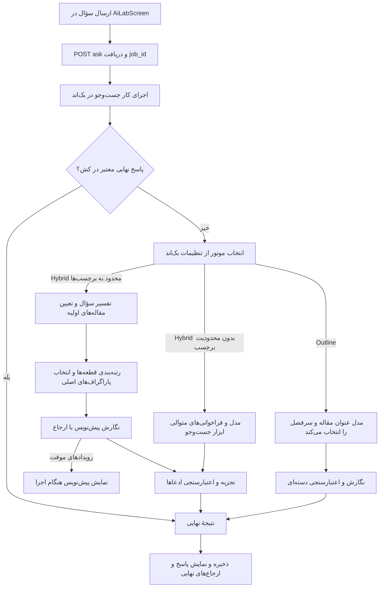

# گزارش مسیر سرچ هوشمند فارمنتا

بازبینی کد شاخهٔ `main` در کامیت `44a8726`. نمونهٔ مورد بررسی «دارودرمانی آرتریت روماتویید» است. محیط محلی موتور `hybrid` با جست‌وجوی محدود به برچسب‌ها را تنظیم کرده بود. نمایهٔ محلی UpToDate و اتصال MySQL مرجع در این محیط در دسترس نبودند. بازتولید این گزارش با عنوان‌ها و بندهای ساختگی انجام شد. نسخهٔ در حال اجرای سرور و شناسهٔ درخواست ناموفق هنوز تأیید نشده‌اند.

**یافتهٔ اصلی.** اصلاح قبلی عنوان‌های دارای عبارت‌هایی مثل `refractory` را پوشش می‌داد. من نتیجهٔ آن تست را به همهٔ عنوان‌های مربوط به شکست درمان تعمیم دادم. در بازتولید جدید، عنوانی که جمعیت را به بیماران دارای بیماری پابرجا با وجود درمان محدود می‌کند، از همان فیلتر عبور کرد و با مقالهٔ عمومی اولویت مساوی گرفت. با جابه‌جا شدن ترتیب فهرست برچسب‌ها، مقالهٔ منتخب هم عوض شد. این خطا پیش از جست‌وجوی پاراگراف رخ داد. [فیلتر عنوان](../../backend/apps/ai_lab/lexical.py#L154) · [رتبه‌بندی مقاله](../../backend/apps/ai_retrieval/retrieval.py#L126)

## ۱. نمای کلی اجرا

گره‌های «پیش‌نویس» و «پاسخ نهایی» دو دادهٔ جدا در همان درخواست‌اند. باز کردن نتیجه از تاریخچه هم همان `job_id` را می‌خواند. [نمایش پاسخ در اپ](../../frontend/src/screens/AiLabScreen.tsx#L375) · [باز کردن نتیجه از تاریخچه](../../frontend/src/screens/AiLabScreen.tsx#L253)

## ۲. ارسال سؤال، پذیرش و اجرای درخواست

1. تابع `send()` فاصله‌های ابتدا و انتهای سؤال را می‌گیرد، وضعیت درخواست در حال اجرا و اعتبار را بررسی می‌کند و یک پیام موقت با وضعیت `running` می‌سازد. فیلد `history` حداکثر چهار **متن سؤال قبلی از همین گفت‌وگو** را دارد. سؤال‌های قبلیِ عیناً برابر با سؤال فعلی از این فهرست کنار گذاشته می‌شوند. کد برای این فهرست بر اساس وضعیت موفق یا ناموفق فیلتر جداگانه‌ای ندارد. فرانت‌اند مدل `luna`، منبع `uptodate` و شناسهٔ ساخته‌شده برای ارسال را به `POST /api/v1/ai-lab/ask/` می‌فرستد. [ساخت درخواست در اپ](../../frontend/src/screens/AiLabScreen.tsx#L190) · [قرارداد API](../../frontend/src/api/aiLab.ts#L98)
2. `AskView` ورود، فعال بودن قابلیت، پلن و شکل داده را کنترل می‌کند. طول سؤال در سرور ۳ تا ۱۵۰۰ نویسه است و تاریخچه حداکثر چهار ورودی دارد. اگر موتور `hybrid` باشد یا صورتحساب فعال باشد، درخواست به `runner.submit()` می‌رود. اجرای قدیمی `outline` با صورتحساب خاموش از ThreadPool فرایند وب استفاده می‌کند. انتخاب موتور را تنظیمات **بک‌اند** انجام می‌دهند. [اعتبارسنجی داده](../../backend/apps/ai_lab/views.py#L36) · [انتخاب مسیر اجرا](../../backend/apps/ai_lab/views.py#L306)
3. در مسیر پایدار، `runner.submit()` ترکیب حساب و `request_id` را کنترل می‌کند. ارسال دوبارهٔ همان داده با همان شناسه همان `job_id` را برمی‌گرداند. سپس رکورد `SearchRun` و رکورد مصرف اعتبار ساخته می‌شوند، ظرفیت هم‌زمان و سقف ساعتی بررسی می‌شوند و کار به صف Celery یا اجرای محلی مجاز تحویل داده می‌شود. ورودی و خروجی پایدار در `SearchRun` رمزگذاری می‌شوند. پیام صف شناسهٔ کار را حمل می‌کند. پاسخ `202` تأیید پذیرش کار است. [پذیرش و صف](../../backend/apps/ai_lab/runner.py#L16) · [اجرای Celery](../../backend/apps/ai_lab/tasks.py#L7) · [ذخیرهٔ رمزگذاری‌شده](../../backend/apps/ai_lab/job_store.py#L13)
4. `runner.execute()` با قفل سطر، کار در صف را یک بار به `running` می‌برد. `views._run()` نبض کار، لغو، زمان انتظار صف و رویدادهای منابع و پیش‌نویس را مدیریت می‌کند و `services.answer()` را صدا می‌زند. بررسی دسترسی به مقاله‌ها و اعتبارسنجی تازگی نمایه در مراحل بعد هم انجام می‌شود. [شروع کارگر](../../backend/apps/ai_lab/runner.py#L111) · [اجرای پاسخ در کارگر](../../backend/apps/ai_lab/views.py#L239)

## ۳. کش و تعیین مسیر مدل

`services.answer()` در ابتدا کش پاسخ نهایی را می‌خواند. کلید آن حساب، متن سؤال، تاریخچه، مدل، موتور، تنظیمات بازیابی، نسخهٔ منبع و امضای کد را در بر می‌گیرد. پاسخ کش‌شده دوباره از نظر اعتبار منبع و دسترسی بررسی می‌شود. در صورت پذیرش، همان پاسخ نهایی برمی‌گردد و `retrieval.stop_reason` به `validated_cache_hit` تغییر می‌کند. اطلاعات انتخاب مقالهٔ اجرای نخست در `retrieval` اجرای کش جایگزین می‌شود. کش پاسخ فقط نتیجه‌های کامل از دید قرارداد برنامه را می‌پذیرد. [انتخاب موتور و کش](../../backend/apps/ai_lab/services.py#L203) · [ورودی‌های کلید کش](../../backend/apps/ai_lab/response_cache.py#L48) · [خواندن پاسخ از کش](../../backend/apps/ai_lab/response_cache.py#L195)

| تنظیم | مسیر در کد | محل تصمیم دربارهٔ مقاله |
| --- | --- | --- |
| `AI_LAB_SEARCH_ENGINE=hybrid` و `AI_LAB_TAG_SCOPED_SEARCH=true` | `answer_hybrid()` سپس `answer_scoped()` | مدل کوئری و مشخصات سؤال را می‌سازد. بک‌اند مقاله‌های اولیه را انتخاب و محدوده را ثابت می‌کند. |
| `hybrid` با `AI_LAB_TAG_SCOPED_SEARCH=false` | `_answer_agent_loop()` | مدل در چند نوبت می‌تواند ابزار جست‌وجو را فراخوانی کند و پاراگراف‌های قبلی را نگه دارد یا کنار بگذارد. محدودهٔ ریشهٔ مسیر محدود به برچسب‌ها در این حالت برقرار نمی‌شود. |
| `AI_LAB_SEARCH_ENGINE=outline` | `services._answer()` | مدل ابتدا شناسهٔ مقاله‌ها را از فهرست عنوان‌ها و سپس شناسهٔ سرفصل‌ها را انتخاب می‌کند. متن بندها بعد از این انتخاب خوانده می‌شود. |

پیش‌فرض کد `outline` است. محیط محلی بررسی‌شده `hybrid`، حالت محدود به برچسب‌ها، اجرای `celery` و پیش‌نویس خاموش داشت. دیدن پیش‌نویس در نسخهٔ کاربر با فعال بودن رویدادهای پیش‌نویس در مسیر پایدار سازگار است. برای تشخیص زیرشاخهٔ موتور و نسخهٔ worker، به دادهٔ همان اجرا نیاز داریم. [تنظیم موتور](../../backend/config/settings/base.py#L651) · [تنظیم حالت محدود و استریم](../../backend/config/settings/base.py#L669) · [انتخاب زیرشاخهٔ Hybrid](../../backend/apps/ai_lab/hybrid_agent.py#L444)

## ۴. مسیر اصلی Hybrid محدود به برچسب‌ها

### تفسیر سؤال و تعیین محدودهٔ مقاله

1. `answer_scoped()` متن اصلی و سؤال‌های قبلی را به مدل می‌دهد. مرحلهٔ `planning` منتظر یک فراخوانی ساخت‌یافتهٔ `search_references` است. فیلدهای کلیدی `query` انگلیسی، `lookup_kind`، `audience`، `keywords` و `question_profile` هستند. پروفایل نوع سؤال، اهداف مرتب‌شده، درخواست رژیم، بیماری‌ها، داروها، یافته‌ها و محدودیت‌ها را مشخص می‌کند. برنامه ساختار را اعتبارسنجی می‌کند و هدف اول را به‌عنوان `intent` می‌گیرد. چند حالت شناخته‌شده، از جمله `disease_question` با هدف درمان، به‌صورت صریح به `topic` تبدیل می‌شوند. اعتبار ساختار با صحت تفسیر بیماری یا دامنهٔ سؤال فرق دارد. کش جداگانهٔ برنامهٔ جست‌وجو می‌تواند همین فراخوانی را بازیابی کند. [برنامه‌ریزی](../../backend/apps/ai_lab/structured_agent.py#L118) · [اعتبارسنجی آرگومان مدل](../../backend/apps/ai_lab/hybrid_agent.py#L163)
2. `HybridRetriever.search()` در جست‌وجوی اول `TreatmentTopicScope` را از سؤال اصلی، نوع جست‌وجو و هدف می‌سازد. مرحلهٔ عمومی، اولیه، بعد از شکست یا ترکیبی از الگوهای واژگانی تشخیص داده می‌شود. جمعیت و شیوهٔ درمان هم الگوهای جدا دارند. اگر `lookup_kind` برابر `topic` نباشد یا هدف با شروط تابع سازگار نباشد، تابع دامنه‌ای برنمی‌گرداند و فیلتر دامنهٔ عنوان غیرفعال می‌شود. برای سؤال عمومی، عنوان‌های دارای نشانگر **شناخته‌شده**ٔ مراحل بعدی یا جمعیت اختصاصی خارج از سؤال کنار می‌روند. [تعیین دامنهٔ سؤال](../../backend/apps/ai_lab/lexical.py#L133) · [اعمال دامنه در جست‌وجو](../../backend/apps/ai_retrieval/retrieval.py#L356)
3. `catalog_ids()` از عبارت‌های کوئری و مفهوم‌های پروفایل به‌دنبال نام‌های جایگزین ایندکس‌شده می‌گردد. نام‌های جایگزین منتخب، فهرست موضوع‌ها را بر اساس مخاطب از `SearchCatalog` برمی‌گردانند. برای سؤال درمانی و در صورت فعال بودن fallback، `treatment_topic_titles()` تا ۶۰ عنوان از نسل فعلی را با جست‌وجوی عبارت در عنوان اضافه می‌کند. حذف بعضی واژه‌های عمومی و قیدهای درمانی قبل از تطابق صورت می‌گیرد. این واکشی همچنان به عبارت ساخته‌شده و عنوان‌های موجود در نسل ایندکس وابسته است. [فهرست برچسب‌ها](../../backend/apps/ai_retrieval/retrieval.py#L204) · [تطابق عنوان](../../backend/apps/ai_lab/retrieval.py#L24) · [فهرست برحسب مخاطب](../../backend/apps/uptodate/search_catalog.py#L76)
4. `_choose_roots()` نسخه‌های مقاله را از نسل فعال می‌خواند. مرتب‌سازی به نوع منبع، مخاطب، هم‌پوشانی با موجودیت‌ها، اولویت عنوان درمانی، امتیاز عنوان و در پایان ترتیب فهرست ورودی متکی است. سپس عنوان ناسازگار و مقالهٔ غیرمجاز حذف می‌شوند. سقف پیش‌فرض سه مقالهٔ اولیه است. اگر گزینه‌ای باقی نماند و fallback فعال باشد، متن عنوان با واژه‌ها و سپس قطعه‌های ایندکس بررسی می‌شوند. در آن مرحلهٔ جایگزین، اگر پروفایل نام بیماری داده باشد، عنوان باید واژه‌های یک بیماری گزارش‌شده را داشته باشد. وقتی مرحلهٔ اولیه حداقل یک ریشه معتبر بپذیرد، این مسیر جایگزین اجرا نمی‌شود. [انتخاب و مسیر جایگزین](../../backend/apps/ai_retrieval/retrieval.py#L126) · [پیش‌فرض تعداد ریشه](../../backend/config/settings/base.py#L681)
5. `SourceScope.bind()` فهرست `roots` را برای همان درخواست یک بار ثبت می‌کند. جست‌وجوی دوم دوباره ریشه انتخاب نمی‌کند. مقالهٔ دیگری می‌تواند از طریق پیوند ثبت‌شدهٔ منبع، با سقف مشخص، وارد `related` شود. در نتیجه انتخاب زودهنگام مقاله روی همهٔ مراحل بعد اثر دارد. [قفل شدن فهرست ریشه](../../backend/apps/ai_retrieval/scope.py#L16) · [بررسی عنوان پیوند](../../backend/apps/ai_retrieval/retrieval.py#L111)

### رتبه‌بندی قطعه و انتخاب پاراگراف

1. متن مرجع پیش‌تر آماده شده است. `ReferenceArticle`، `ReferenceSection` و `ReferenceParagraph` عنوان، سلسله‌مراتب و متن اصلی را نگه می‌دارند. در آماده‌سازی، بندهای خیلی کوتاه، خیلی بلند، ناوبری و بعضی جداول پیچیده ممکن است شمارهٔ بازیابی نگیرند. `SearchChunk` مجموعه‌ای از این بندهای قابل جست‌وجو در یک بخش را به همراه شناسه‌های بند، مسیر سرفصل و متن مناسب بردارسازی نگه می‌دارد. بردار به قطعه تعلق دارد. ارجاع نهایی از بند اصلی ساخته می‌شود. [آماده‌سازی پاراگراف‌ها](../../backend/apps/ai_lab/document.py#L95) · [ساخت قطعه](../../backend/apps/ai_retrieval/chunking.py#L34) · [بازخوانی و ارجاع به بند](../../backend/apps/ai_retrieval/retrieval.py#L679)
2. `lexical_ids()` رتبهٔ متنی PostgreSQL و رتبهٔ مبتنی بر سرفصل را می‌سازد. اگر نسل و بردارها آماده باشند، در دور اول جست‌وجوی برداری هم به‌موازات آن انجام می‌شود. در حالت محدود به برچسب‌ها، هر دو دامنهٔ ثبت‌شده را رعایت می‌کنند. خطای سرویس بردار می‌تواند مسیر را به جست‌وجوی واژگانی کاهش دهد و علت در `degraded` می‌آید. نتیجهٔ رتبه‌بندی هم کش جداگانه دارد. [جست‌وجوی متنی و سرفصل](../../backend/apps/ai_retrieval/retrieval.py#L262) · [جست‌وجوی برداری](../../backend/apps/ai_retrieval/retrieval.py#L327) · [کش رتبه‌بندی](../../backend/apps/ai_retrieval/retrieval.py#L381)
3. سه فهرستِ واژگانی، برداری و سرفصل با فرمول `sum(1 / (60 + position))` ترکیب می‌شوند. بعد نوع و اولویت عنوان، جمعیت، تطابق واژه‌ها و امتیاز سرفصل در رتبه اثر می‌گذارند. برای خط اول، نشانهٔ اولیه در سرفصل و متن هم اولویت جدا دارد. ابتدا حداکثر دو قطعه از هر بخش در فهرست متنوع می‌آیند و بقیه به انتهای فهرست می‌روند. سقف‌های پیش‌فرض ۴۰ نامزد در رتبه‌بندی، ۸ قطعهٔ منتخب و ۶۰۰۰ توکن برای بودجهٔ انتخاب‌اند. این تنوع در سطح **بخش** است و سهمیهٔ اجباری برای مقالهٔ عمومی یا بند شروع درمان ایجاد نمی‌کند. [ادغام رتبه‌ها](../../backend/apps/ai_retrieval/retrieval.py#L38) · [انتخاب قطعه](../../backend/apps/ai_retrieval/retrieval.py#L425) · [مقادیر پیش‌فرض](../../backend/config/settings/base.py#L669)
4. برای درمان دارویی، در صورت فعال بودن تکمیل رژیم، جای حداکثر دو قطعه برای اطلاعات دارویی مرتبط در نظر گرفته می‌شود. سپس قطعه‌ها به بندهای اصیل تبدیل می‌شوند. `focus_passages()` موارد تکراری یا بخش‌های آشکارا خارج از هدف را کنترل می‌کند و به توصیه، دوز، محدودیت، پایش، مدت و شرط‌های همراه امتیاز می‌دهد. `SourceContext` زیربخش‌های درمانی، بندهای مجاور، پیوند بخش‌ها و مقاله‌های مرتبط را در حد مجاز اضافه می‌کند. بعد فیلتر دوباره اعمال و شرط‌های لازم کنار بندهای مرتبط نگه داشته می‌شوند. برای سؤال عمومی، زیربخش مراحل بعد در مقالهٔ اصلی همچنان می‌تواند وارد شواهد شود. [تکمیل و فیلتر دوباره](../../backend/apps/ai_retrieval/retrieval.py#L488) · [امتیاز بندها](../../backend/apps/ai_retrieval/evidence.py#L80) · [دنبال کردن ساختار و پیوندها](../../backend/apps/ai_retrieval/source_context.py#L351)
5. `missing_facets()` بررسی تقریبی می‌کند که نشانه‌ای از هر هدف در مجموعهٔ متن وجود دارد یا یک بند دارای الگوی دوز با نام دارو و بیماری سازگار است. در صورت تشخیص کمبود، مسیر محدود به برچسب‌ها **یک جست‌وجوی تکمیلی** دارد، حتی اگر مقدار پیش‌فرض `AI_LAB_HYBRID_MAX_SEARCH_ROUNDS` برابر ۳ باشد. جست‌وجوی تکمیلی داخل ریشه‌ها و پیوندهای ثبت‌شده می‌ماند. یک توصیه یا دوزِ محدود به زیرگروه می‌تواند از این بررسی تقریبی عبور کند و جست‌وجوی تکمیلی را منتفی کند. [بررسی تقریبی پوشش](../../backend/apps/ai_lab/structured_agent.py#L70) · [شرط دور تکمیلی](../../backend/apps/ai_lab/structured_agent.py#L155)
6. `ordered_evidence()` بندها را با توجه به نقش‌های باقی‌مانده، سرفصل‌های پوشش‌داده‌نشده و تطابق متن مرتب می‌کند. `_admit_evidence()` گروهِ بند و شرط‌های همراهش را تا سقف توکن می‌پذیرد. اگر یک گروه در فضای باقیمانده جا نشود، به گروه بعد می‌رود. شناسه‌های کوتاه `P1`، `P2` و مانند آن در همین مرحله ساخته می‌شوند. وجود یک مقاله در `roots` به‌تنهایی نشان نمی‌دهد که حتی یک بند از آن به مدل نگارش رسیده باشد. [ترتیب بندها](../../backend/apps/ai_lab/structured_agent.py#L99) · [پذیرش بند در بودجه](../../backend/apps/ai_lab/hybrid_agent.py#L411)

اگر درخواست رسانه‌ای تشخیص داده شود و `media_answer()` منبعی پیدا کند، مسیر اصلی نگارش متن می‌تواند در همین نقطه با کارت‌های اصلی جدول یا تصویر خاتمه یابد. نتیجهٔ صریح حداکثر دو رسانهٔ یکتا دارد. توضیح درخواستی جدول مسیر جداگانهٔ خواندن سلول‌های اصلی و ارزیابی همان توضیح را طی می‌کند. [انشعاب رسانه](../../backend/apps/ai_lab/structured_agent.py#L175) · [نتیجهٔ رسانه](../../backend/apps/ai_retrieval/media.py#L246) · [توضیح جدول](../../backend/apps/ai_retrieval/media.py#L307)

## ۵. نگارش، اعتبارسنجی و نمایش نهایی

### پیش‌نویس چگونه به اپ می‌رسد؟

`answer_scoped()` سؤال، تاریخچه، پروفایل، الزام‌های پاسخ و بندهای پذیرفته‌شده با عنوان، مسیر بخش و ارتباط منبع را به مدل نگارش می‌دهد. این فراخوانی سقف ۲۴۰۰ توکن خروجی دارد. شناسهٔ `luna` نام ثابت رابط است و مدل واقعی در `AI_LAB_MODEL` تعیین می‌شود. سرویس مدل متن را با SSE برمی‌گرداند. هنگام دریافت متن، سرور `answer_delta` می‌سازد. در اجرای پایدار و با فعال بودن `AI_LAB_STREAM_ANSWER_DRAFTS`، `DraftBuffer` آن را در وضعیت موقت کار و جریان رویداد ثبت می‌کند. رویداد اپ از نوع NDJSON است. [ارسال متن و ساخت دلتا](../../backend/apps/ai_lab/structured_agent.py#L191) · [دریافت SSE مدل](../../backend/apps/ai_lab/streaming.py#L63) · [ثبت پیش‌نویس](../../backend/apps/ai_lab/views.py#L222)

اپ `GET /api/v1/ai-lab/results/<job_id>/stream/` را می‌خواند و `answer_reset` یا `answer_delta` را در `answer_drafts` اعمال می‌کند. شمارهٔ رویداد برای ادامه دادن جریان استفاده می‌شود. اگر جریان قطع یا غیرقابل استفاده باشد، اپ با `GET /api/v1/ai-lab/results/<job_id>/` وضعیت همان کار را می‌خواند. پیش‌نویس تنها هنگام `turn.status = running` با برچسب «پیش‌نویس در حال بررسی» دیده می‌شود. متن پیش‌نویس می‌تواند به اپ برسد و بعد خطای پایان stream، محدودیت طول یا خطای شناسهٔ ارجاع رخ دهد. در آن حالت، نتیجهٔ درخواست می‌تواند `failed` باشد. [جمع کردن رویداد در اپ](../../frontend/src/screens/AiLabScreen.tsx#L131) · [جریان نتیجه](../../backend/apps/ai_lab/stream_views.py#L108) · [کنترل انتهای خروجی مدل](../../backend/apps/ai_lab/streaming.py#L170)

### چه چیزی از پیش‌نویس باقی می‌ماند؟

1. مدل در انتهای ادعاهایش شناسه‌ای مانند `[P3]` می‌نویسد. `_claims()` متن را بر اساس پاراگراف، نشانهٔ فهرست، محل ارجاع و پایان جمله به `A1`، `A2` و موارد بعدی می‌شکند. متن بدون ارجاع قابل‌تشخیص می‌تواند کنار گذاشته و به‌عنوان `uncited_omitted` ثبت شود. اگر مدل ارجاع با قالب معتبر اما شناسهٔ ناشناخته بسازد، `UNKNOWN_SOURCE_ID` می‌تواند کل کار را به وضعیت خطا ببرد. ارجاع یک منبع پیوندخورده، وابستگی به بند والد را هم وارد مجموعهٔ بررسی می‌کند. [تجزیهٔ ادعاها](../../backend/apps/ai_lab/hybrid_agent.py#L241)
2. `_verify()` ادعاها، سؤال اصلی، پروفایل و بندهای ارجاع‌شده به همراه قیود مجاور را به یک فراخوانی جدا می‌فرستد. این فراخوانی از همان مدل تنظیم‌شده استفاده می‌کند. پاسخ JSON شامل `supported`، `sufficient` و `coverage` است. فقط جمله‌هایی که شناسه‌شان در `supported` است می‌مانند. وضعیت `answered` به جمله‌های باقی‌مانده، `sufficient=true` و کامل بودن ردیف‌های پوشش وابسته است. خطا یا کمبود در یک ردیف پوشش می‌تواند نتیجه را `partial` کند و جمله‌های تأییدشده بمانند. کدِ این مرحله اعتبار شناسه‌ها و ساختار پوشش را چک می‌کند. داوری معنایی دربارهٔ پشتیبانی و ارتباط با سؤال به پاسخ ارزیاب وابسته است. کل ایندکس برای ارزیاب باز نمی‌شود. [بررسی ادعاها](../../backend/apps/ai_lab/hybrid_agent.py#L268) · [بررسی پوشش](../../backend/apps/ai_lab/hybrid_agent.py#L291)
3. اگر جمله‌ای باقی نماند، یا متن موجود ارجاع قابل‌تشخیص نداشته باشد، `verify_answer()` می‌تواند یک بازنویسی کوتاه از **همان بندهای پذیرفته‌شده** بخواهد و دوباره آن را ارزیابی کند. باقی ماندن حتی یک جمله باعث بازگشت نتیجهٔ همان ارزیابی می‌شود، از جمله وقتی پوشش ناقص است. این مرحله مقالهٔ تازه انتخاب نمی‌کند. اگر متن اولیه شامل اطلاعات مفیدی بوده اما ارجاع آن معتبر نبوده، ادعا با متن پیش‌نویس جایگزین نمی‌شود. [بازنویسی محدود](../../backend/apps/ai_lab/hybrid_agent.py#L314)
4. بک‌اند `answer_blocks` را از ادعاهای تأییدشده و `items` را از ارجاع‌های پذیرفته‌شده می‌سازد. سه حالت پاسخ `answered`، `partial` و `not_found` داخل `result.parts[]` قرار می‌گیرند. وضعیت **کار** می‌تواند `complete` باشد و وضعیت **پاسخ** `not_found`. برای نمونه `claims_not_verified` یعنی بند برای مدل انتخاب شد و در خروجی نهایی ادعای تأییدشده باقی نماند. `scoped_evidence_exhausted` به‌تنهایی مشخص نمی‌کند نتیجه کاملاً خالی بوده یا فقط ناقص بوده است. باید `part.status` و تعداد بندها را هم خواند. [ساخت نتیجه و ثبت علت پایان](../../backend/apps/ai_lab/structured_agent.py#L220)
5. پس از تکمیل، `finish()` مصرف را در مسیر پایدار تسویه و نتیجه را در رکورد رمزگذاری‌شده و کش کار ثبت می‌کند. سپس رویداد `complete` با دادهٔ نتیجه منتشر می‌شود. خروجی پایدار از API نتیجه نیز قابل خواندن است. فرانت‌اند با رسیدن نتیجه، پیش‌نویس موقت را پنهان و `answer_blocks` یا خلاصهٔ نهایی را نمایش می‌دهد. دکمهٔ ارجاع هر بند با تطبیق `source_id` در `part.items` ساخته می‌شود و می‌تواند به مقاله و بند دقیق، یا به رسانهٔ اصلی، برود. [تسویه و ذخیرهٔ نتیجه](../../backend/apps/ai_lab/views.py#L186) · [افزودن ارجاع‌ها به متن](../../frontend/src/screens/AiLabScreen.tsx#L383) · [باز کردن مقاله](../../frontend/src/screens/AiLabScreen.tsx#L234)

فهرست قابل مشاهدهٔ «منابع» را باید جدا از ارجاع جمله دید. هنگام اجرا، فهرست از `findings` می‌آید. پس از اتمام، ترکیبی از `items` و رسانه‌های مرتبط است و در `not_found` می‌تواند تا سه مورد متنیِ مرتبط هم نشان دهد. به همین دلیل دیدن عنوان یک مقاله در فهرست، به‌تنهایی دلیل استفاده از آن در جملهٔ نهایی نیست. برای این مورد، `answer_blocks[].source_ids` و `items[].target.params.id` را تطبیق دهید. [ساخت فهرست منابع](../../frontend/src/screens/AiLabScreen.tsx#L340)

## ۶. مسیرهای جایگزین

**Hybrid بدون محدودیت برچسب‌ها.** مدل فراخوانی ابزار و نگارش را در یک حلقه مدیریت می‌کند. دورهای جست‌وجو محدودند. در جست‌وجوی تکمیلی مدل می‌تواند با `retain_source_ids` بخشی از شواهد قبلی را نگه دارد یا فهرست را خالی کند. جدیدترین محتوای ابزار جای شواهد قدیمی را برای فراخوانی بعدی می‌گیرد. در انتها همان تجزیهٔ ادعا و اعتبارسنجی اجرا می‌شود. خروجی کل هر دو مسیر Hybrid می‌تواند `uptodate-hybrid-v1` باشد. برای تشخیص حالت محدود، `part.retrieval.engine` را بررسی کنید که در مسیر محدود `tag_scoped` و در حلقه `hybrid_agent` است. [حلقهٔ ابزار](../../backend/apps/ai_lab/hybrid_agent.py#L454) · [نگهداری شواهد قبلی](../../backend/apps/ai_lab/hybrid_agent.py#L507)

**Outline.** برنامه‌ریز می‌تواند سؤال را به حداکثر سه بخش تقسیم کند و برای هر بخش عبارت کوتاه جست‌وجو بسازد. نامزدها از جست‌وجوی معمول UpToDate می‌آیند و در صورت امکان عنوان‌های نزدیک از نمایه اضافه می‌شوند. فیلتر دامنه قبل از ارائهٔ مقاله‌ها به مدل اجرا می‌شود. مدل از بین عنوان‌ها حداکثر سه مقاله و سپس حداکثر سه سرفصل منتخب انتخاب می‌کند. برای موضوع درمان، خواننده می‌تواند زیربخش‌های درمانی هم‌خانواده را هم باز کند. مدل، بندها را در دسته‌های حداکثر شش‌تایی توضیح می‌دهد و خروجی هر دسته دوباره بررسی می‌شود. یک مرحلهٔ پیگیری مقاله‌های پیوندخورده هم وجود دارد. این مسیر پیش‌نویس جمله‌به‌جملهٔ Hybrid را تولید نمی‌کند. نام نتیجه `uptodate-outline-v1` است. [برنامه‌ریزی Outline](../../backend/apps/ai_lab/services.py#L105) · [انتخاب مقاله و سرفصل](../../backend/apps/ai_lab/services.py#L303) · [خواندن بندها](../../backend/apps/ai_lab/outline.py#L76) · [ارزیابی دسته‌ای](../../backend/apps/ai_lab/services.py#L417)

## ۷. بازتولید اشکال در کامیت فعلی

بازتولید با همان تابع `_choose_roots()`، پروفایل بیماریِ «روماتویید»، سؤال عمومی فارسی، کوئری `rheumatoid arthritis pharmacotherapy` و سقف یک ریشه انجام شد. فقط دریافت متادیتای مقاله با دادهٔ ساختگی جایگزین شد. شناسه‌ها در جدول نمونه‌اند. [تابع رتبه‌بندی](../../backend/apps/ai_retrieval/retrieval.py#L126)

| شناسهٔ نمونه | عنوان ساختگی | از فیلتر سؤال عمومی عبور کرد؟ | اولویت عنوان |
| --- | --- | --- | --- |
| `100` | Management of rheumatoid arthritis | بله | `1` |
| `101` | Management of rheumatoid arthritis in patients with persistent disease despite treatment | بله | `1` |
| نمونهٔ کنترل | Treatment of refractory rheumatoid arthritis | خیر | عنوان با الگوی روشن درمان مقاوم تشخیص داده شد |

با ورودی `["101", "100"]`، ریشه `101` انتخاب شد. با ورودی `["100", "101"]`، ریشه `100` انتخاب شد. بنابراین شکل عنوانِ «بیماری پابرجا با وجود درمان» راه عبور از اصلاح قبلی را نشان می‌دهد. با سقف پیش‌فرض سه ریشه، عنوان تخصصی و عمومی می‌توانند هم‌زمان وارد بازیابی شوند و در سطح بند برای ظرفیت رقابت کنند. در آزمایش جداگانه، یک بند ساختگی با **توصیه و دوزِ محدود به همان زیرگروه** به `missing_facets()` داده شد و خروجی `[]` بود. این مرحله وجود نشانهٔ توصیه و دوز را تشخیص می‌دهد و برای پوشش درمان عمومی الزام مستقلی ندارد. [تشخیص دامنهٔ عنوان](../../backend/apps/ai_lab/lexical.py#L154) · [محاسبهٔ کمبود پوشش](../../backend/apps/ai_lab/structured_agent.py#L70)

آزمون قبلی با عنوانی شامل واژهٔ صریح `refractory` و یک برچسب مصنوعی نوشته شده بود. آن تست درست عمل می‌کند و حالت جدول بالا را پوشش نمی‌دهد. نتیجه‌ای که قبلاً اعلام کردم باید به همان دادهٔ آزمون محدود می‌ماند. [آزمون قبلی](../../backend/apps/ai_retrieval/test_retrieval.py#L72)

## ۸. تشخیص محل خطا در یک درخواست واقعی

از تب Network اپ وب، کافی است شناسهٔ `job_id` و پاسخ همان `GET /api/v1/ai-lab/results/<job_id>/` را بررسی کنیم. باز کردن جست‌وجو از تاریخچه هم همین نتیجه را می‌خواند. این مسیر به حساب مالک درخواست محدود است. برای تشخیص اولیه، شناسهٔ مقاله‌ها، عنوان‌ها، نام مرحله‌ها و کد وضعیت کافی‌اند و متن کامل سؤال‌های خصوصی، محتوای منابع یا توکن ورود لازم نیست. [API نتیجه](../../backend/apps/ai_lab/views.py#L384) · [فیلدهای قابل مشاهده](../../backend/apps/ai_lab/jobs.py#L112)

| چه چیزی را ببینیم؟ | چه نتیجه‌ای از آن می‌گیریم؟ |
| --- | --- |
| `result.pipeline`، `parts[0].retrieval.engine` و `metrics.response_cache` | مسیر واقعی و کش مشخص می‌شوند. در کش معتبر، جزئیات رتبه‌بندی اجرای اول با اطلاعات کش جایگزین شده‌اند. |
| `parts[0].queries`، `intent`، `lookup_kind`، `audience` و در مسیر محدود `retrieval.objectives` | می‌توان دید ترجمه یا پروفایل، سؤال عمومی را به مرحله، جمعیت یا نوع جست‌وجوی دیگری برده است یا خیر. |
| `parts[0].retrieval.searches[0].scope.roots` و `scope.related` | اگر مقالهٔ مقاوم در `roots` باشد، مسئله از انتخاب اولیه می‌آید. اگر فقط در `related` باشد، رابطه، شناسهٔ والد و نوع پیوند را بررسی می‌کنیم. |
| `findings` با `citation.verification=retrieved` و `parts[0].items` | می‌توان مقاله‌ها و سرفصل‌های معرفی‌شده در حال اجرا را با ارجاع‌های نهایی مقایسه کرد. این داده فهرست کامل نامزدهای اولیه یا همهٔ قطعه‌های ردشده را ندارد. |
| `parts[0].answer_blocks[].source_ids` و `items[].target.params` | برای هر ادعای نهایی روشن می‌شود از کدام مقاله، سرفصل و بند ارجاع گرفته است. |
| وضعیت کار، `parts[0].status`، `retrieval.stop_reason`، `coverage` و `stages[].stage` | می‌توان خطای اجرا، نبود شواهد، رد ادعاها و پاسخ ناقص را از هم تشخیص داد. وجود مرحلهٔ `answer_repair` نشانهٔ تلاش بازنویسی است. |
| نسخه یا شناسهٔ بیلد سرویس بک‌اند و worker | مشخص می‌شود درخواست با چه کدی اجرا شده است. `GET /api/v1/ai-lab/status/?diagnostics=1` برای حساب staff می‌تواند موتور و آمادگی معنایی سرویس وب را نشان دهد. این پاسخ، به‌تنهایی نسخهٔ پردازهٔ worker را ثابت نمی‌کند. |

دادهٔ فعلی برای بازسازی کامل تصمیم مدل کافی نیست. خروجی نهایی معمولاً شرح اینکه چرا یک عنوان رد یا پذیرفته شد، ترتیب کامل نامزدهای مقاله، و دلیل رد هر ادعای پیش‌نویس را ذخیره نمی‌کند. در نتیجه برای تعیین علت اجرای گزارش‌شده، به شناسهٔ همان کار و تطبیق ریشه‌ها، شواهد و ارجاع‌ها نیاز داریم. [خروجی ممیزی بازیابی](../../backend/apps/ai_retrieval/retrieval.py#L571) · [تشخیص وضعیت سرور](../../backend/apps/ai_lab/views.py#L269) · [فیلدهای تله‌متری](../../backend/apps/ai_lab/telemetry.py#L79)

## ۹. نتیجه برای اصلاح بعدی

جای اصلی اصلاح، **تصمیم این است که کدام مقاله پاسخ‌دهندهٔ اصلی است**. الگوهای عنوان باید در کنار شناسهٔ مفهوم مرجع، نوع مقاله و شواهد واقعیِ پوشش درمان عمومی استفاده شوند. برای سؤال عمومی باید ابتدا مقالهٔ هم‌دامنه‌ای پیدا شود که مسیر اصلی درمان را پوشش می‌دهد. منابع تخصصی به اندازهٔ نیاز و با نقش مشخص وارد شوند. معیار پوشش هم باید بسنجد که توصیهٔ پیدا شده برای همان مرحله و جمعیت است. وجود یک توصیه یا عدد دوز در شاخهٔ تخصصی، برای پاسخ عمومی کافی نیست. بعد از آن، نگارش و اعتبارسنجی جمله‌ها معنی پیدا می‌کند.

برای پذیرش این اصلاح می‌توان چهار حالت را روی **یک مجموعه‌منبع یکسان** سنجید. سؤال عمومی با و بدون «کامل» باید مقالهٔ پایهٔ یکسانی داشته باشد. سؤال صریح دربارهٔ شکست درمان باید به مقالهٔ همان مرحله برسد. اگر مقالهٔ عمومی حاضر است و در برچسب جا افتاده، باید پیش از رتبه‌بندی بندها بازیابی شود. اگر تنها مقالهٔ یک مرحلهٔ خاص موجود است، نتیجه باید محدودیت پوشش را روشن نشان دهد. در هر چهار مورد باید هم شناسهٔ مقالهٔ اولیه و هم شناسهٔ ارجاعِ ادعای نهایی بررسی شود.
